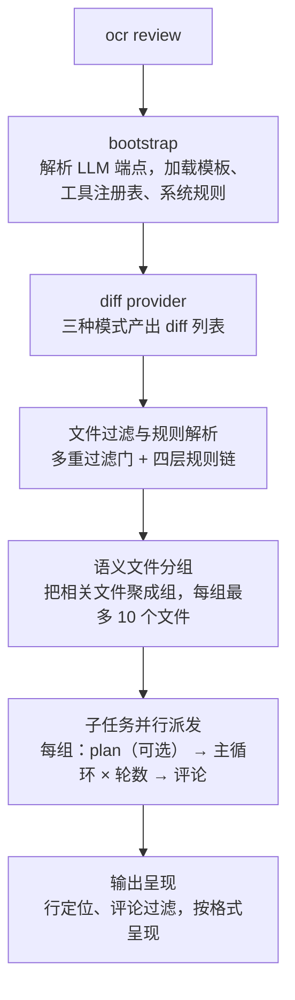

# open-code-review 从入门到精通

**版本与核实信息**

| 项目 | 说明 |
|---|---|
| 主题 | OpenCodeReview（Alibaba 开源的 AI 代码审查 CLI 工具，命令名为 `ocr`） |
| 基于版本 | v1.13.x（撰写时 npm 最新稳定版为 1.13.3） |
| 核实日期 | 2026 年 11 月 2 日 |
| 资料来源 | 官方仓库（github.com/alibaba/open-code-review）内附中文文档共 15 篇、npm registry、官方安装脚本；教程中出现的全部命令、参数与配置项均已对照核实 |
| 前置条件 | Git ≥ 2.41；NPM 安装方式需要 Node.js ≥ 18 |
| 操作系统假设 | 命令示例默认在 macOS 与 Linux 的 bash、zsh 环境中执行，Windows（PowerShell）存在差异之处在相应章节单独说明 |

> 版本差异声明：OpenCodeReview 迭代较快，本教程标注「xx 版本起」的行为仅适用于所指版本线；未标注的描述以 v1.13.x 为准。任何命令的完整参数列表可通过 `ocr <子命令> --help` 获取，与官方文档（https://open-codereview.ai/docs ，文档可在仓库 `pages/src/content/docs/` 目录中直接查阅）为准。

**目录**

- 第一部分 入门：第 1 章 认识与原理概览；第 2 章 安装；第 3 章 配置 LLM；第 4 章 首次评审
- 第二部分 日常使用：第 5 章 三种评审模式与会话恢复；第 6 章 输出解读与会话查看器；第 7 章 全文件扫描审计；第 8 章 规则定制
- 第三部分 团队与自动化：第 9 章 团队规范：规则链与语言设置；第 10 章 Agent 集成与委托模式；第 11 章 CI/CD 流水线
- 第四部分 精通：第 12 章 参数调优与成本控制；第 13 章 MCP 扩展与自定义工具；第 14 章 架构剖析；第 15 章 故障排查手册（FAQ）

---

# 第一部分 入门

## 第 1 章 认识与原理概览

在决定安装和配置一套新工具之前，通常需要先回答三个问题：它能替代什么工作；它凭什么可靠；它有哪些边界。本章围绕这三个问题展开，帮助读者在动手安装之前建立对 OpenCodeReview 的整体认识。完成本章学习后，读者应能判断该工具是否适合当前团队，并理解第 2 章到第 15 章内容所依赖的核心概念。

### 1.1 OpenCodeReview 是什么

OpenCodeReview（官方简称 OCR，注意与本教程语境中的「光学字符识别」无关）是一款 AI 驱动的代码审查 CLI（Command Line Interface，命令行界面）工具。它的前身是阿里巴巴集团内部使用的官方 AI 代码审查助手，经过两年时间服务了数万名开发者并识别出数百万个代码缺陷，于 2026 年以 Apache-2.0 许可证开源。仓库地址为 https://github.com/alibaba/open-code-review ，官方网站与文档站点为 https://open-codereview.ai 。

其基本工作方式如下：

1. 读取 Git 的 diff（差异，即两次代码状态之间的逐行变更记录）；
2. 将变更文件交给一个配置好的 LLM（Large Language Model，大语言模型），并通过一个具备工具调用能力的 Agent（智能体）组织上下文；
3. 生成以行为精度单位锚定的结构化评审意见，每条意见包含代码位置、问题描述与可选的修复建议。

「评审（Review）」一词在本教程中统一指对变更代码进行的机器辅助审查，下文不再区分「审查」与「评审」。

除了针对 diff 的评审，OCR 还提供 `ocr scan` 命令，对整个文件乃至整个目录做全量扫描，适用于审计不熟悉的代码库，或针对没有有意义 diff 的目录进行检查。这一能力在第 7 章单独展开。

### 1.2 通用 Agent 做代码评审的三个问题

如果直接把通用编程 Agent（例如 Claude Code）配合提示词用于代码评审，常见的问题有三类：

| 问题 | 表现 | OCR 的对应机制 |
|---|---|---|
| 覆盖不全 | 变更集较大时，Agent 倾向于选择性地只评审部分文件，其余文件被遗漏 | 由工程逻辑精确决定「哪些文件需要评审、哪些应被过滤」，保证应评审的变更全部进入评审 |
| 位置漂移 | 报告的问题与实际代码位置对不上，行号或文件引用发生偏移 | 评论定位与重新定位模块由工程逻辑驱动，把评论锚定到 diff 中的精确行 |
| 效果不稳定 | 自然语言提示词驱动的评审质量随措辞细节大幅波动 | 规则匹配、文件打包、评论过滤等关键环节采用模板引擎与固定流程，不依赖语言模型自由发挥 |

这些问题的根源在于纯语言驱动的架构对评审流程缺乏硬约束，这构成了 OCR 核心设计的出发点。

### 1.3 核心设计：确定性工程与 Agent 混合

OCR 的核心设计理念是把「确定性工程」与「Agent」组合使用，各自负责最擅长的部分。其中「确定性工程」指评审流程中由工程逻辑（而非语言模型）保证正确性的环节。

**确定性工程，负责不可出错的环节：**

- **精准的文件筛选**：明确哪些文件需要评审、哪些应当过滤（二进制文件、测试文件、生成代码、敏感路径等，详见第 8 章）。
- **智能的文件打包**：把语义相关的文件归并为同一个评审单元，例如 `message_en.properties` 与 `message_zh.properties`。每个包独立运行为一个子任务，上下文相互隔离。这一分治策略使评审在超大变更集上保持稳定，并天然支持并发。
- **精细化的规则匹配**：按文件特征（扩展名、路径）匹配对应的评审规则，把模型的注意力聚焦到该文件真正需要关注的问题上，从源头减少噪声。
- **外挂的评论定位与反思模块**：独立于主评审流程的定位模块与过滤模块，系统性地提升评论的位置准确率与内容准确率。

**Agent，负责动态决策与上下文召回：**

- **场景化提示词**：针对代码评审任务的模板经过深度调优，在提升效果的同时降低 token 消耗。
- **场景化工具集**：从大规模生产数据的工具调用轨迹中取舍沉淀而成的专属工具集（读文件、搜代码、发评论等共六种，详见第 13 章），比通用工具集在评审场景下更稳定、更可预期。

### 1.4 效果基准与设计取舍

官方基准测试 AACR-Bench 用 50 个热门开源仓库中的 200 个真实 Pull Request、10 种编程语言构建，由 80 余名资深工程师交叉标注，共包含 1505 个已标注缺陷（数据集发布于 Hugging Face：Alibaba-Aone/aacr-bench）。

| 指标 | 含义 | 意义 |
|---|---|---|
| F1 | 准确率与召回率的调和均值 | 衡量综合评审质量的最佳单一指标 |
| Precision（准确率） | 报告的问题中真正有效的比例 | 越高则误报越少，人工确认成本越低 |
| Recall（召回率） | 真实缺陷中被发现的比例 | 越高则漏报越少 |
| Avg Time | 每次评审的实际耗时 | 影响 CI 流水线等待时间 |
| Avg Token | 每次评审消耗的 token 总量 | 直接影响 API 成本 |

基准结论值得注意两点：其一，在相同底层模型下，OCR 的 F1 与 Precision 显著高于将同一模型作为通用 Agent 使用的情况，且只消耗约九分之一的 token，速度更快；其二，OCR 的 Recall 低于通用 Agent，这是官方有意的取舍，即以更少的漏报记录换取更低的噪声。换言之，OCR 的定位是与人工评审配合的高信号提醒者，而不是穷举式的缺陷扫描器（更宽的覆盖可考虑第 7 章的全量扫描）。

### 1.5 适用与不适用场景

**适用场景：**

- 个人开发者在提交前对工作区变更做自查（第 4 章）；
- 对 feature 分支相对主分支的变更做提交前评审（第 5 章）；
- 团队把代码评审自动化接入 GitHub Pull Request 与 GitLab Merge Request（第 11 章）；
- 审计陌生代码库，或把 Claude Code、Codex、Cursor 等编程 Agent 与评审能力组合（第 10 章）。

**明确不适用的场景：**

- 非 Git 版本控制系统（SVN、Mercurial 等）不受支持，diff 提供方通过 shell 直接调用 `git`；
- OCR 只读取 diff 与文件内容，不会在评审过程中执行被评审仓库中的代码，因此不能用于运行测试。

### 1.6 命令与生态全景

OCR 的主体是一个名为 `ocr` 的命令。完整命令总览如下表，各命令在第 4 章至第 13 章逐步展开。

| 命令 | 别名 | 作用 |
|---|---|---|
| `ocr review` | `ocr r` | 运行代码评审并输出评论（主命令） |
| `ocr scan` | `ocr s` | 无需 Git diff，扫描完整文件 |
| `ocr delegate` | — | 委托模式：输出文件清单与规则，由宿主 Agent 执行评审 |
| `ocr rules check <file>` | — | 显示某个文件路径适用的评审规则及其来源 |
| `ocr config set/unset` | — | 读写持久化配置 |
| `ocr config provider / model` | — | 交互式配置 LLM 供应商与模型 |
| `ocr llm test / providers / models` | — | 测试连通性、列出内置供应商、列出账户模型 |
| `ocr auth` | — | ChatGPT 登录（登录、状态、登出） |
| `ocr session` | `ocr sessions` | 列出、查看、导出、删除评审会话 |
| `ocr viewer` | — | 启动浏览器会话查看器 |
| `ocr completion` | — | 生成 shell 补全脚本 |
| `ocr version` | — | 打印版本信息 |

生态方面，OCR 提供 Claude Code、Codex、Cursor、Kimi Code 插件、OpenCode 原生集成与通用 Agent Skill，支持 GitHub Actions、GitLab CI 持续集成与 SARIF 报告上传，可通过 MCP（Model Context Protocol，模型上下文协议）服务器扩展审查所需的外部工具，并通过 OpenTelemetry 输出遥测数据。这些能力分别在第 10 至第 13 章讲解。

---

## 第 2 章 安装

安装是全部后续工作的基础。本章覆盖五种受支持的安装方式、安装后的验证方法、shell 补全配置，以及 OCR 在磁盘上的状态目录布局。完成本章学习后，读者应能在本机或 CI 环境中正确安装 `ocr`，并知道遇到故障时去哪里检查。

### 2.1 前置条件

- **Git ≥ 2.41**。OCR 依赖 Git 完成 diff 生成、代码搜索与仓库操作，版本过旧会导致部分子命令行为不可预期。
- **Node.js ≥ 18**。仅 NPM 安装方式需要；采用 Homebrew、安装脚本、静态二进制或源码构建时不依赖 Node.js。

### 2.2 安装方式总览

| 方式 | 适用场景 | 是否需要 Node.js |
|---|---|---|
| NPM（官方推荐） | 日常开发环境，CLI 保持自动更新 | 需要 |
| Homebrew | macOS 或 Linux 包管理器用户 | 不需要 |
| 安装脚本（curl 或 PowerShell） | CI 基础镜像、无界面环境批量安装 | 不需要 |
| GitHub Release 静态二进制 | 网络受限、或想精确控制二进制来源 | 不需要 |
| 从源码构建 | 需要修改 OCR 本身，或运行于无预编译二进制的平台 | 不需要（需要 Go ≥ 1.26.10） |

### 2.3 NPM 安装（推荐）

安装命令：

```bash
npm install -g @alibaba-group/open-code-review
```

安装完成后 `ocr` 命令全局可用。固定到特定版本时追加 `@<版本号>`：

```bash
npm install -g @alibaba-group/open-code-review@1.13.3
```

**自动更新机制**：通过 NPM 安装时，`ocr` 默认自动保持最新（静态二进制安装不受此机制影响）。每次运行 `ocr` 时，启动器会在后台静默检查 registry 上的最新版本，发现更新即自动升级，不影响当次评审；两次检查之间有 18 分钟冷却间隔。

相关环境变量：

| 变量 | 默认值 | 说明 |
|---|---|---|
| `OCR_NO_UPDATE` | 未设置 | 设为任意非空值即关闭自动更新，例如 `export OCR_NO_UPDATE=1` |
| `OCR_UPDATE_INTERVAL` | `18`（分钟） | 调整两次版本检查的间隔 |

卸载：

```bash
npm uninstall -g @alibaba-group/open-code-review
```

### 2.4 Homebrew 安装（macOS 与 Linux）

```bash
brew install open-code-review
```

该 formula 从源码构建并安装 `ocr` 二进制。后续升级使用 `brew upgrade open-code-review`。

### 2.5 安装脚本

该脚本封装了从 GitHub Release 下载静态二进制的过程并附带完备性校验，适合 CI 基础镜像与无界面环境，支持 darwin 与 linux 的 amd64 与 arm64 平台。

```bash
curl -fsSL https://open-codereview.ai/install.sh | sh
```

脚本识别三个环境变量：

| 变量 | 默认值 | 用途 |
|---|---|---|
| `OCR_INSTALL_DIR` | `/usr/local/bin` | 安装 `ocr` 二进制的位置 |
| `OCR_VERSION` | 最新 release | 固定到某个 release 标签（如 `v1.2.3`） |
| `OCR_GITHUB_MIRROR` | 未设置 | 通过 GitHub 路径前缀型镜像域名下载二进制及校验和（如 `gh-proxy.com`） |

镜像用法示例（GitHub 访问较慢的地区）：

```bash
export OCR_GITHUB_MIRROR='YOUR_MIRROR_DOMAIN'
```

关于镜像的安全提示：镜像必须是裸域名，不带 `https://` 前缀与结尾斜杠，且属于路径前缀型镜像（即形如 `https://<镜像>/github.com/alibaba/open-code-review/releases/download/<版本>/…` 的代理形式；重写域名的镜像不适用）。设置镜像后，二进制与其 `sha256sum.txt` 都将从该镜像下载，这意味着恶意镜像可以同时提供被篡改的二进制和与之匹配的校验和，完整性保证因此失效。若无法完全信任镜像，应对照 GitHub Releases 页面上的上游 `sha256sum.txt` 验证下载文件。

Windows（PowerShell 5.1 及以上）使用对应的 PowerShell 脚本：

```powershell
irm https://open-codereview.ai/install.ps1 | iex
```

同样识别 `OCR_INSTALL_DIR`、`OCR_VERSION`、`OCR_GITHUB_MIRROR`（通过 `$env:OCR_INSTALL_DIR` 等设置）。默认安装位置为 `%LOCALAPPDATA%\Programs\ocr`。

### 2.6 GitHub Release 静态二进制

不希望引入 Node.js 的用户可直接下载静态二进制（二进制名是 `opencodereview`，NPM 启动器为了易用安装为 `ocr`，见 15.7 节说明）：

```bash
# macOS（Apple Silicon）
curl -Lo ocr https://github.com/alibaba/open-code-review/releases/latest/download/opencodereview-darwin-arm64
chmod +x ocr && sudo mv ocr /usr/local/bin/ocr

# macOS（Intel）
curl -Lo ocr https://github.com/alibaba/open-code-review/releases/latest/download/opencodereview-darwin-amd64
chmod +x ocr && sudo mv ocr /usr/local/bin/ocr

# Linux x86_64
curl -Lo ocr https://github.com/alibaba/open-code-review/releases/latest/download/opencodereview-linux-amd64
chmod +x ocr && sudo mv ocr /usr/local/bin/ocr

# Linux ARM64
curl -Lo ocr https://github.com/alibaba/open-code-review/releases/latest/download/opencodereview-linux-arm64
chmod +x ocr && sudo mv ocr /usr/local/bin/ocr

# Windows（AMD64）
curl -Lo ocr.exe https://github.com/alibaba/open-code-review/releases/latest/download/opencodereview-windows-amd64.exe
```

每个 release 同时发布 `sha256sum.txt` 校验和文件，用于验证完整性：

```bash
curl -LO https://github.com/alibaba/open-code-review/releases/latest/download/sha256sum.txt
shasum -a 256 -c sha256sum.txt --ignore-missing
```

### 2.7 从源码构建

仅当需要修改 OCR 本身，或在某个没有预编译二进制的平台上运行时采用。

前置条件：Go ≥ 1.26.10（https://go.dev/dl/）、Git、Make。

```bash
git clone https://github.com/alibaba/open-code-review.git
cd open-code-review
make build
# 产出 dist/opencodereview（Windows 上为 dist/opencodereview.exe）
sudo cp dist/opencodereview /usr/local/bin/ocr
```

面向其他平台的交叉编译目标：

```bash
make build-linux-amd64
make build-linux-arm64
make build-darwin-amd64
make build-darwin-arm64
make build-windows-amd64
make build-windows-arm64
make build-all    # 一次性构建全部六个平台
make sha256sum    # 产出 sha256sum.txt
make dist         # clean → build-all → sha256sum → 写入 VERSION 文件（release 流水线所用步骤）
```

运行测试套件：

```bash
make test
```

### 2.8 验证安装与 shell 补全

无论二进制来自哪种安装方式，以下三条命令依次验证版本、顶层用法与 review 子命令参数：

```bash
ocr version             # 打印版本号、短 Git commit、平台与构建日期
ocr --help              # 顶层用法
ocr review --help       # review 命令的完整参数列表
```

出现 `command not found` 时，确认安装位置在 `PATH` 环境变量上：

```bash
which ocr
echo $PATH
```

`ocr` 支持 bash、zsh、fish 与 PowerShell 的 Tab 补全：

```bash
# bash：仅当前会话生效
source <(ocr completion bash)
# bash：持久生效（Linux）
ocr completion bash > /etc/bash_completion.d/ocr
# bash：持久生效（macOS，Homebrew 环境）
ocr completion bash > $(brew --prefix)/etc/bash_completion.d/ocr

# zsh：先确认补全子系统已启用，然后持久安装
echo "autoload -U compinit; compinit" >> ~/.zshrc
ocr completion zsh > "${fpath[1]}/_ocr"

# fish：仅当前会话
ocr completion fish | source
# fish：持久
ocr completion fish > ~/.config/fish/completions/ocr.fish
```

PowerShell：

```powershell
# 仅当前会话
ocr completion powershell | Out-String | Invoke-Expression
# 持久：生成脚本并在 PowerShell 配置文件中加载
ocr completion powershell > ocr.ps1
```

### 2.9 状态目录与卸载

OCR 的全部状态集中存放于用户主目录下的隐藏目录 `~/.opencodereview/`（Windows 上即 `%USERPROFILE%\.opencodereview`），具体如下：

| 路径 | 存放内容 |
|---|---|
| `~/.opencodereview/config.json` | LLM 端点、语言、遥测等配置（由 `ocr config set` 管理） |
| `~/.opencodereview/rule.json` | 可选的用户级全局评审规则 |
| `~/.opencodereview/sessions/<编码后的仓库路径>/<会话 id>.jsonl` | 每次评审会话的流式 JSONL（JSON Lines，每行一个 JSON 对象的文本格式）记录，供 `ocr viewer` 使用 |
| `~/.opencodereview/last-update-check 等文件` | NPM 启动器的后台更新检查状态（静态二进制安装不写这些文件） |
| `<仓库>/.opencodereview/rule.json` | 可选的项目级评审规则，可以安全提交到仓库 |

除 NPM 方式的临时二进制下载外，OCR 不在上述目录之外写入任何内容，删除该目录即完成干净的卸载。

完整卸载步骤：

```bash
npm uninstall -g @alibaba-group/open-code-review   # 卸载 NPM 安装
sudo rm /usr/local/bin/ocr                          # 卸载二进制安装
rm -rf ~/.opencodereview                            # 清除配置与会话历史
```

---

## 第 3 章 配置 LLM

运行评审之前必须先配置可用的 LLM 端点（除非使用第 10 章的委托模式，该模式不需要 OCR 端的 LLM 配置）。本章覆盖配置文件的编辑方式、内置供应商、连通性测试、端点解析顺序、自定义供应商与密钥管理。完成本章学习后，读者应能完成一次配置并通过连通性测试。

### 3.1 配置文件与三种编辑方式

配置持久化在 `~/.opencodereview/config.json`。修改它有三种方式：

1. **交互式界面（TUI，Text-based User Interface，终端交互界面）**：`ocr config provider` 与 `ocr config model`，带有引导菜单，适合首次配置；
2. **命令行写入**：`ocr config set <键> <值>`，适合脚本与 CI 等无人值守环境；
3. **手动编辑 JSON 文件**：不推荐。下次 `ocr config set` 写入时文件会被重新格式化。

### 3.2 交互式配置（推荐用于首次配置）

```bash
ocr config provider
```

交互式界面会依次引导完成三件事：选择一个内置的或自定义的 provider（供应商，即 LLM 服务提供方及其端点定义）、填入 API key、挑选模型。保存后会自动运行一次 `ocr llm test` 验证端点连通性。

之后更换模型使用：

```bash
ocr config model
```

### 3.3 非交互式配置（适用于 CI 与无 TUI 环境）

用 `ocr config set` 直接写入同一份配置文件：

```bash
ocr config set provider                    anthropic
ocr config set model                       claude-opus-4-6
ocr config set providers.anthropic.api_key sk-ant-xxxxxxxxxx
```

- `provider`：当前使用的供应商名称；
- `model`：该供应商下使用的模型名；
- `providers.<名称>.api_key`：该供应商的 API key。

`ocr config unset <键>` 清除已保存的配置值，支持的键包括 `provider`、`max_tokens`、`effort`、`custom_providers.<名称>` 与 `mcp_servers.<名称>`。删除当前启用的自定义供应商时，`provider` 与 `model` 一并被清空，需要重新运行 `ocr config provider` 选择。

### 3.4 内置供应商一览

下列供应商随 OCR 发布，Base URL 与调用协议已预置。多数供应商需要 API key；若 `providers.<名称>.api_key` 未设置，OCR 会自动回退到对应的环境变量。

| 名称 | 协议 | Base URL | API key 环境变量 |
|---|---|---|---|
| `anthropic` | anthropic | `https://api.anthropic.com` | `ANTHROPIC_API_KEY` |
| `bedrock` | anthropic-bedrock | 由 `aws_region` 决定 | 无（使用 AWS 凭证链） |
| `chatgpt` | openai-responses | `https://api.openai.com/v1` | 不适用（使用 Sign in with ChatGPT 登录） |
| `openai` | openai | `https://api.openai.com/v1` | `OPENAI_API_KEY` |
| `openai-responses` | openai-responses | `https://api.openai.com/v1` | `OPENAI_RESPONSES_API_KEY` |
| `openrouter` | openai | `https://openrouter.ai/api/v1` | `OPENROUTER_API_KEY` |
| `gemini` | openai | `https://generativelanguage.googleapis.com/v1beta/openai` | `GEMINI_API_KEY` |
| `dashscope` | openai | `https://dashscope.aliyuncs.com/compatible-mode/v1` | `DASHSCOPE_API_KEY` |
| `dashscope-tokenplan` | openai | `https://token-plan.cn-beijing.maas.aliyuncs.com/compatible-mode/v1` | `DASHSCOPE_TOKENPLAN_KEY` |
| `volcengine` | openai | `https://ark.cn-beijing.volces.com/api/v3` | `ARK_API_KEY` |
| `deepseek` | openai | `https://api.deepseek.com` | `DEEPSEEK_API_KEY` |
| `tencent-tokenhub` | openai | `https://tokenhub.tencentmaas.com/v1` | `TENCENT_TOKENHUB_API_KEY` |
| `hy-tokenplan` | openai | `https://api.lkeap.cloud.tencent.com/plan/v3` | `TENCENT_HUNYUAN_TOKENPLAN_KEY` |
| `iflytek` | openai | `https://spark-api-open.xf-yun.com/v1` | `SPARK_API_KEY` |
| `kimi` | openai | `https://api.moonshot.cn/v1` | `MOONSHOT_API_KEY` |
| `kimi-global` | openai | `https://api.moonshot.ai/v1` | `MOONSHOT_GLOBAL_API_KEY` |
| `z-ai` | openai | `https://open.bigmodel.cn/api/paas/v4` | `Z_AI_API_KEY` |
| `mimo` | openai | `https://api.xiaomimimo.com/v1` | `MIMO_API_KEY` |
| `minimax` | openai | `https://api.minimax.io/v1` | `MINIMAX_GLOBAL_API_KEY` |
| `minimax-cn` | openai | `https://api.minimaxi.com/v1` | `MINIMAX_API_KEY` |
| `baidu-qianfan` | openai | `https://qianfan.baidubce.com/v2` | `QIANFAN_API_KEY` |
| `siliconflow` | openai | `https://api.siliconflow.com/v1` | `SILICONFLOW_GLOBAL_API_KEY` |
| `siliconflow-cn` | openai | `https://api.siliconflow.cn/v1` | `SILICONFLOW_API_KEY` |
| `novita` | openai | `https://api.novita.ai/openai` | `NOVITA_API_KEY` |
| `xai` | openai | `https://api.x.ai/v1` | `XAI_API_KEY` |

内置供应商的推荐模型列表只为 `ocr config model` 提供选择建议，并不限制手动指定的模型。指定的模型既不在内置列表、也不在 `providers.<名称>.models` 中时，OCR 会向 stderr 输出警告，模型有效性由供应商侧在请求时验证（自定义供应商仍执行原本的 `--model` 校验规则）。

协议一栏说明了该端点使用的请求格式：`anthropic` 为 Anthropic Messages API；`openai` 为 OpenAI Chat Completions 兼容格式；`openai-responses` 为 OpenAI Responses API（`/v1/responses`）；`anthropic-bedrock` 为 AWS Bedrock 侧的 Anthropic Messages API（以 AWS 签名代替 key）。

### 3.5 测试连通性

```bash
ocr llm test
```

该命令以与 `ocr review` 完全相同的方式解析 LLM 端点，发送一条预置的简短对话请求，并打印解析结果与模型回复：

```text
Source: provider:anthropic
URL:    https://api.anthropic.com
Model:  claude-opus-4-6
<模型的回复>
✓ Connection test successful
```

常见错误与含义：

- `no valid LLM endpoint configured`：尚未配置出完整的端点三元组，回到 3.2 或 3.3 重新配置；
- `401` / `403`：token 错误、过期，或缺少所需权限。

非零退出码表示端点未完整配置，或请求失败，错误信息会指明具体是哪一种。

### 3.6 端点解析顺序与环境变量复用

OCR 按固定顺序解析 LLM 端点：**已保存的配置 → `OCR_LLM_*` 环境变量 → `ANTHROPIC_*` 环境变量 → shell 启动脚本中的变量**。解析的取值策略是「第一个完整三元组生效，而非最后一个」：一旦某个来源提供了完整的 URL、token 与模型三元组，后面的来源即被忽略。

两个常用结论：

- 若配置文件中已经写全了 `llm.*` 三个键，环境变量会被忽略；要让环境变量生效，需要删除对应的配置键（`ocr config unset` 或直接删除键值）；
- 已为 Claude Code 配置好 `ANTHROPIC_BASE_URL`、`ANTHROPIC_AUTH_TOKEN`、`ANTHROPIC_MODEL` 的环境会自动被识别，无需再写一份配置。

配置文件里除 3.4 的 `providers.*` 形态外，还存在旧版的 `llm.*` 配置块（`llm.url`、`llm.auth_token`、`llm.model`）。官方 CI 示例（第 11 章）正是通过 `ocr config set llm.auth_token` 写入凭证，两种形态都能被端点解析链读取。

### 3.7 自定义供应商

任何不在内置表中的供应商名称都视为自定义供应商，至少需要提供 `url` 与 `protocol` 两项，`protocol` 取 `anthropic`、`openai`、`openai-responses` 或 `anthropic-bedrock` 之一。以下示例配置一个内部网关：

```bash
ocr config set provider                             my-gateway
ocr config set custom_providers.my-gateway.url      https://gateway.internal.com/v1
ocr config set custom_providers.my-gateway.protocol openai
ocr config set custom_providers.my-gateway.model    llama-3-70b
ocr config set custom_providers.my-gateway.api_key  "$MY_API_KEY"
```

`url` 既可以填 API 的 Base URL，也可以填完整的 `/responses` 之类端点路径，OCR 会自动归一化。使用 Ollama 运行完全本地的模型，就是一个指向本地 OpenAI 兼容端点的自定义供应商：

```bash
ocr config set provider                          ollama
ocr config set custom_providers.ollama.url       http://127.0.0.1:11434/v1
ocr config set custom_providers.ollama.protocol  openai
ocr config set custom_providers.ollama.model     qwen3:32b
ocr config set custom_providers.ollama.api_key   ollama
```

两点注意：Ollama 不校验 API key，但自定义供应商要求非空的 `api_key`（它没有环境变量回退机制），因此填写任意占位值即可；模型必须支持原生工具调用（function calling），否则评审会一直失败于工具解析环节，具体见 15.1 节。

**覆盖内置供应商的 Base URL**：把内置供应商指向自建网关（例如 LiteLLM）时，设置 `providers.<名称>.url`：

```bash
ocr config set provider                   litellm
ocr config set model                      openai/gpt-5.4
ocr config set providers.litellm.api_key  "$LITELLM_API_KEY"
ocr config set providers.litellm.url      https://gateway.internal:8000/v1
```

`url` 设置后优先于预设 Base URL，清空后回退到预设默认值。

**发送厂商专属请求字段**：部分供应商需要非标准请求字段时，用 `extra_body` 合并进每次请求，无需改源码：

```bash
ocr config set providers.anthropic.extra_body '{"thinking":{"type":"disabled"}}'
```

**额外的重试状态码**：默认已对 408、409、429 与所有 5xx 自动重试；个别供应商用非标准 4xx 状态码（如 403、400）临时表示限流时，可将其加入重试：

```bash
ocr config set custom_providers.my-gateway.retry_codes 403,400
```

**AWS Bedrock**：`bedrock` 使用 `anthropic-bedrock` 协议，请求通过标准 AWS 凭证链做 SigV4 签名而非 API key。地域与 profile 均可选（不设置时回退到 `AWS_REGION` 与 `AWS_PROFILE`）：

```bash
ocr config set provider                      bedrock
ocr config set model                         us.anthropic.claude-sonnet-4-6
ocr config set providers.bedrock.aws_region  us-west-2
ocr config set providers.bedrock.aws_profile example-profile
```

注意：`llm.protocol` 与环境变量 `OCR_LLM_PROTOCOL` 不支持 bedrock（该配置形态只描述「URL 加 token」，没有存放地域与 profile 的位置），设置会被明确拒绝而非静默忽略。

### 3.8 从命令获取 API key

除直接把 key 写入配置文件外，还可以用 `api_key_cmd` 让 OCR 在每次调用时运行一条命令，从密钥管理器（1Password、`pass`、`gopass` 等）获取：

```bash
ocr config set providers.anthropic.api_key_cmd "op read op://dev/anthropic/api-key"
```

操作系统自带密钥环同理，key 保存在 Keychain 或 Secret Service 中而不落在 `config.json`：

```bash
# macOS Keychain
ocr config set providers.anthropic.api_key_cmd "security find-generic-password -s ocr-anthropic -w"

# Linux（Secret Service：GNOME Keyring 等）
ocr config set providers.anthropic.api_key_cmd "secret-tool lookup service ocr-anthropic"
```

解析优先级：静态 `api_key` 优先（两者都设置时忽略命令并输出警告）；其次运行 `api_key_cmd`；两者都未设置时才回退到供应商对应的环境变量。

命令约束与风险说明：命令每次 `ocr` 调用时运行一次，需在 60 秒内完成；去首尾空白后的**单行** stdout 即为 key；非零退出、空输出、多行输出或输出超过 64 KiB 都会被视为硬错误，OCR 不会静默回退。该值会作为 shell 命令执行，因此 `config.json` 属于可信输入，应确保其归属正确且其他用户不可写（OCR 写入时使用 `0600` 权限）。Windows 上命令通过 `cmd.exe` 执行而非 `sh`，两方的元字符与展开规则互不兼容（详见 15.7 节）。

### 3.9 ChatGPT 登录（预览功能）

内置的 `chatgpt` 供应商使用公开的 Sign in with ChatGPT 流程，不使用 API key 环境变量：

```bash
ocr auth login --provider chatgpt
ocr config set provider chatgpt
ocr config set providers.chatgpt.model <模型标识>
ocr llm test

ocr auth status --provider chatgpt       # 查看登录状态
ocr auth logout --provider chatgpt --account <已保存的 client-id>   # 登出
ocr llm models                           # 列出当前账户可用模型
```

配置限制：供应商级别的 `extra_body` 仅接受 `reasoning`、`text` 与 `prompt_cache_key` 三个字段，端点、协议与凭证覆盖会被拒绝。该功能为预览状态，账户模型列表与限流规则以官方文档 chatgpt-preview 篇为准。

### 3.10 设置评审语言

`language` 决定评审评论的输出语言，未设置时默认为英文：

```bash
ocr config set language 中文
ocr config set language English
```

---

## 第 4 章 首次评审

本章用一个最小示例仓库跑通第一次完整评审，涉及工作区模式、范围预览与输出阅读三个动作。完成本章学习后，读者应能独立完成一次评审，并能读懂输出中的每一段信息。三种评审模式的完整讨论位于第 5 章。

### 4.1 准备一个最小示例仓库

创建一个全新的 Git 仓库并制造一次带问题的变更：

```bash
mkdir ocr-demo && cd ocr-demo
git init
mkdir src
```

写入一个含有明显缺陷的文件 `src/rate.js`（价格计算时用字符串拼接导致类型错误，并缺少参数校验）：

```javascript
// src/rate.js
function calcTotal(items, couponRate) {
  const sum = items.reduce((a, item) => a + "" + item.price);
  return sum * couponRate;
}

module.exports = { calcTotal };
```

将变更放入暂存区（Git 中由 `git add` 标记、将被包含在下一次提交的变更集合）：

```bash
git add src/rate.js
```

评审结果取决于所用模型与对应的评审规则，同一份代码在不同模型下的输出并不相同；本节示例仅表示输出格式。

### 4.2 预览评审范围

正式评审会消耗 token，因此先确认 OCR 会选中哪些文件。`--preview`（简写 `-p`）执行与真实评审相同的过滤流水线，但跳过 LLM 调用，因此不产生任何费用：

```bash
ocr review --preview
```

预期输出类似：

```text
src/rate.js             added
1 file(s) selected for review
```

若计划评审的文件没有出现在列表中，输出会给出排除原因（如 `binary`、`user_exclude`、`unsupported_ext`、`default_path`、`too_large` 等）。各原因的含义与修复方式见 8.4 节。

### 4.3 运行评审

不附加任何模式参数的 `ocr review` 以**工作区模式**运行，评审全部 staged（已暂存）、unstaged（已修改未暂存）与 untracked（未跟踪）变更：

```bash
ocr review
```

一次典型运行的输出由三部分构成：以 `[ocr]` 为前缀的进度行、若干评论块、以及结尾摘要行：

```text
[ocr] 1 file(s) changed, reviewing 1 in /path/to/ocr-demo
[ocr]   ▶ file_read "src/rate.js"
[ocr]   ✔ file_read (15ms)
[ocr] Plan completed for src/rate.js
[ocr]   ▶ code_comment …
[ocr]   ✔ code_comment (…)

─── src/rate.js:3-4 ───
reduce 的初始值未提供，且以字符串拼接累加价格，求和结果将是字符串连接而非数值。
建议使用初始值 0 并按数值累加。

-   const sum = items.reduce((a, item) => a + "" + item.price);
+   const sum = items.reduce((a, item) => a + item.price, 0);

─── src/rate.js:5 ───
couponRate 未做范围与类型校验，外部传入 NaN 或负数时静默产出错误总价。

[ocr] Summary: 1 file(s) reviewed, 2 comment(s), ~12000 token(s) used (input: ~9800, output: ~2200), 1m2s elapsed
```

评论块的结构：第一行以 `路径:起始行-结束行` 标示评论锚定的行范围；正文为评审意见；随后的 `- / +` 两段是模型建议的替换代码（即当前代码与建议代码的 diff 形式），部分评论只有正文没有建议。

摘要行逐字段含义：

- `1 file(s) reviewed`：实际送入模型评审的文件数（被过滤的文件不计入）；
- `2 comment(s)`：最终保留的评审评论数；
- `~12000 token(s) used`：本次运行消耗的 token 总量，分为 input 与 output 两项；
- `1m2s elapsed`：总耗时。

没有任何评论的运行同样是成功（退出码为 0），摘要行会照常打印。

### 4.4 提供业务背景

`ocr review` 支持 `--background`（简写 `-b`）注入审核所需的业务上下文，这是官方文档明确指出对评审质量提升最有效的单一参数。模型带着「这批改动想做什么」的背景去评审，可以减少为理解意图而发生的读取往返：

```bash
ocr review --background "本次改动为优惠券结算折扣计算，要求 couponRate 在 0 到 1 之间"
```

业务上下文的更多用法（含基于文件的注入与团队实践）见 9.4 节。

### 4.5 面向程序的机器可读输出

需要把评审结果交给其他程序处理时（例如脚本、上游 Agent 或 CI），使用 JSON 输出：

```bash
ocr review --format json --audience agent > review.json
```

`--format` 决定输出载荷的形态（`text` 为人类可读文本，`json` 为机器可读评论数组，`sarif` 为静态分析结果交换格式报告，见第 6 章）；`--audience agent` 会屏蔽全部进度行，让 stdout 只保留最终结果。完整的 JSON 结构与字段说明见 6.3 节。

### 4.6 首次运行常见问题

| 现象 | 原因与处理 |
|---|---|
| `not a git repository` | 当前目录不在 Git 工作树内。先 `cd` 进入仓库，或用 `--repo /path/to/repo` 显式指定仓库根 |
| `no valid LLM endpoint configured` | 端点未配置完整，按第 3 章重新配置后以 `ocr llm test` 验证 |
| `401` / `403` | API key 错误、过期或权限不足，复查 3.4 节的 key 与协议配对是否正确 |
| 选中的文件比自己预期多或少 | 运行 `ocr review --preview` 查看每个文件的排除原因，对应修复方式见 8.4 节 |
| 评审出现 `No tool calls parsed` 循环 | 模型不支持原生工具调用（本地小模型常见），见 15.1 节 |

---

# 第二部分 日常使用

## 第 5 章 三种评审模式与会话恢复

第一次评审跑通之后，实际使用中的主要问题是「评审什么」：工作区里改了很多东西，未必都想在同一个评审里处理。本章讲清 OCR 的三种评审目标模式的语义、互斥约束，以及评审中断后的恢复方法。完成本章学习后，读者应能精确控制每次评审的范围，并掌握崩溃或中断后的续跑手段。

### 5.1 模式总览

| 模式 | 触发方式 | 评审对象 | 典型用途 |
|---|---|---|---|
| 工作区模式（默认） | 运行 `ocr review` 不附加模式参数 | staged + unstaged + untracked 变更 | 提交前自查 |
| 区间模式 | `--from <ref> --to <ref>` | `merge-base(from, to)..to` 引入的变更 | feature 分支相对主分支的评审 |
| Commit 模式 | `--commit <sha>`（简写 `-c`） | 单个提交相对其父提交的 diff | 评审特定 commit |

三种模式**互斥**：同时传入 `--from`/`--to` 与 `--commit` 会直接报错。除模式参数外，`review` 常用的通用参数见下表（完整列表以 `ocr review --help` 为准）：

| 参数 | 默认 | 说明 |
|---|---|---|
| `--repo <path>` | 当前目录 | Git 仓库根 |
| `--format <fmt>` | `text` | 输出格式：`text`、`json` 或 `sarif` |
| `--audience <who>` | `human` | `human` 输出进度行；`agent` 完全屏蔽进度行 |
| `--output <path>` | 标准输出 | 将结果写入文件，`-` 表示标准输出 |
| `--background <text>` | 无 | 注入业务背景，见 9.4 节 |
| `--concurrency <n>` | `8` | 并行评审的最大子任务数 |
| `--timeout <minutes>` | `15` | 每个子任务的时间预算（分钟），`0` 关闭任务期限 |
| `--rule <file>` | 无 | 自定义 JSON 评审规则文件路径，覆盖项目级与全局 `rule.json`，见第 8 章 |
| `--resume <session-id>` | 无 | 从先前兼容的会话恢复，见 5.5 节 |

### 5.2 工作区模式的取数细节

工作区模式通过两条 Git 命令组装变更：

- `git diff HEAD` 获取已跟踪文件的变更（staged 与 unstaged 合并对比 HEAD；若为空则回退到 `git diff --staged`）；
- `git ls-files --others --exclude-standard` 获取 untracked 文件，从磁盘读取内容并按「整文件新增」处理。

这通常正是提交前需要评审的内容。若希望评审范围更小一些，用选择性 `git add` 控制暂存区，工作区模式自然会跟着缩小。

### 5.3 区间模式：只看分支引入的变更

```bash
ocr review --from main --to feature-branch
```

OCR 计算 `merge-base(main, feature-branch)..feature-branch` 并评审该区间的 diff。其中 merge-base（合并基准）指两个分支最近的共同祖先提交。这样做的效果是：评审对象只包含 feature 分支自己引入的变更，而不包含分支切出之后「顺带」落到 `main` 上的其他无关变更。CI 集成（第 11 章）正是以区间模式运行的。

### 5.4 Commit 模式

```bash
ocr review --commit abc123
ocr review -c abc123
```

评审 `git show abc123` 产生的 diff，即单个提交自身引入的变更。把大改动拆成一系列小提交并逐个评审，是规避「单文件 diff 过大被丢弃」（见 12.4 节）的实用做法。

### 5.5 会话持久化与中断恢复

每次评审都会把会话记录写入 `~/.opencodereview/sessions/<编码后的仓库路径>/<会话 id>.jsonl`。会话（session）是一次评审运行的完整转录，checkpoint（检查点）则是会话中逐文件记录的中间完成状态。正常完成的文本输出只展示评审结果，不打印会话 id；可以通过以下方式获取：

- 用 `--format json` 运行，JSON 载荷中的 `session_id` 字段即是；
- 用会话命令查找：

```bash
ocr session list                  # 列出当前仓库的会话（--limit 控制数量，--json 输出 JSON）
ocr session show <session-id>     # 查看会话元数据与逐文件检查点状态
ocr session comments <session-id> # 输出会话中记录的所有评审评论
```

区间或 Commit 模式评审被 Ctrl-C 或意外中断后，先列出会话，再从目标一致的会话恢复：

```bash
ocr review --from main --to feature-branch --resume <session-id>
ocr review --commit abc123 --resume <session-id>
```

恢复逻辑是严格的，以下任一情形都会导致整次恢复被拒绝（而不是部分复用）：

- 工作区评审不支持恢复；
- 评审模式不一致：区间会话不能以 Commit 模式恢复；
- 解析出的输入不一致：ref 写法不参与比较（`abc1234` 与其完整哈希视为同一提交），但同一 ref 若现在解析出不同 diff，或规则与过滤器改变导致选中的文件集合变化，恢复即被拒绝；
- 切换供应商或模型必须通过 `--provider` / `--model` 显式声明，经由配置文件或环境变量发生的变化一律拒绝；
- `--resume` 不能与 `--preview` 同时使用。

被拒绝的恢复不会留下任何产物：不创建会话、不写检查点、不调用 LLM。

### 5.6 模式选择对照

| 场景 | 建议模式 |
|---|---|
| 提交前自查当前改动 | 工作区模式 |
| 评审整个 feature 分支相对 main 的积攒变更 | 区间模式 |
| 评审单个 commit（Code Review 中某个可疑提交） | Commit 模式 |
| 变更特别大，担心单文件 diff 超限 | 拆分成多个小 commit 后逐个用 Commit 模式 |

---

## 第 6 章 输出解读与会话查看器

拿到评审输出只是第一步；判断输出是否可信、把结果纳入工作流、需要时回放整个评审过程，是更重要的日常能力。本章覆盖三种输出格式的结构、退出码语义、会话子命令与本地 Web 查看器。完成本章学习后，读者应能把评审输出接入文件、终端与浏览器三种阅读路径，并为团队脚本提供可解析的接口。

### 6.1 输出格式与受众参数

两个参数各管一件事，需要组合使用：

- `--format <text|json|sarif>` 决定输出载荷形态；
- `--audience <human|agent>` 决定进度行是否出现。

取值组合的行为：

| 组合 | stdout 内容 | 进度行的去向 |
|---|---|---|
| `--audience human`（默认）+ text | 进度行 + 评论 + 摘要 | stdout |
| `--audience human` + json/sarif | 仅单一可解析文档 | 实时写入 **stderr**，因此解析器只看见干净的 stdout |
| `--audience agent` | 仅最终摘要或 JSON | 完全不出现 |

两个实用示例：

```bash
ocr review --format json > result.json   # 进度行显示在终端上，stdout 是单个 JSON 文档
ocr review --format json | jq .summary   # 直接把 stdout 管道给解析器
```

注意 `--audience agent` 并不隐含 `--format json`，二者是相互独立的开关。全局参数 `--color <auto|always|never>`（可放在子命令前后）控制 ANSI 颜色；`auto` 只在 stdout 是终端时着色，因此管道与重定向天然得到纯文本。

### 6.2 文本输出结构

文本输出共三段：进度行（`--audience human` 时）、评论块（评论在文件评审完成后流式产出）、结尾摘要行，结构与 4.3 节所述一致。评论块标题中的行范围来自第 14 章描述的锚定算法；`start_line` 为 0 的评论表示未能自动定位，是「问题真实，但需人工定位」的显式信号（JSON 中以 `start_line: 0`、`end_line: 0` 出现）。

### 6.3 JSON 载荷结构

`--format json` 的 stdout 恒为恰好一个 JSON 对象（绝不会是裸数组）：

```json
{
  "status": "success",
  "llm": {
    "provider": "anthropic",
    "model": "claude-opus-4-6"
  },
  "summary": {
    "files_reviewed": 9,
    "comments": 1,
    "total_tokens": 21344,
    "input_tokens": 18012,
    "output_tokens": 3332,
    "elapsed": "1m12s"
  },
  "comments": [
    {
      "path": "src/foo.go",
      "content": "Concurrent map access without a lock — wrap with sync.RWMutex.",
      "start_line": 42,
      "end_line": 47,
      "existing_code": "m[k] = v",
      "suggestion_code": "mu.Lock(); defer mu.Unlock(); m[k] = v",
      "thinking": "…模型的推理，此字段可选…"
    }
  ]
}
```

顶层字段说明：

| 字段 | 说明 |
|---|---|
| `status` | 运行终态。带运行清单（manifest）的输出为 `complete`、`partial`、`failed`、`skipped`；否则为 `success`、`completed_with_warnings`、`completed_with_errors`。`skipped` 也用于没有可评审文件的情况 |
| `llm` | 实际解析出的模型标识；`provider` 仅在使用命名供应商时存在 |
| `message` | 可选的人类可读摘要，如 `No comments generated. Looks good to me.` |
| `summary` | 运行聚合：`files_reviewed`、`comments`、各 token 计数、`elapsed`；`skipped` 运行时省略 |
| `comments` | 评论数组，恒存在，可能为空；字段见表中示例 |
| `warnings` | 可选。有子任务失败时出现，描述受影响文件与错误 |
| `session_id` | 可选；需要恢复时传给 `--resume` |
| `resume` | 可选。恢复运行时存在，包含复用与重跑文件计数、前后模型 |

提示：不要通过「对象形状」区分「无变更」与「评审过但零发现」，要么读 `summary.files_reviewed`，要么读 manifest 的 `terminal_state`。完全无文件可评审时会返回一个 `status: "skipped"` 的外壳对象（例如 `"status": "skipped", "message": "No supported files changed.", "comments": []`），便于调用方分支处理。

### 6.4 退出码

| 退出码 | 含义 |
|---|---|
| `0` | 评审完成。可能为零评论，也可能带非致命警告（如个别子任务失败、某文件超过 token 上限） |
| `1` | 致命错误：参数错误、无法解析出 LLM 端点、全部子任务失败等，错误文本输出到 stderr |

单个文件评审失败不会拖垮整个运行（失败被隔离为警告），这是有意设计。解析 JSON 时注意读取 `warnings` 数组或 stderr 文本以确认个别文件状态。

### 6.5 结果落盘

`--output <path>`（简写 `-o`）将结果写入 UTF-8 文件，`-` 表示标准输出。文件在首次写入时才创建，运行失败不会截断已存在的文件；text 格式写入时自动剥离 ANSI 颜色码。

```bash
ocr review --format json --output result.json
```

### 6.6 会话子命令

| 命令 | 作用 |
|---|---|
| `ocr session list [--json] [--limit <n>] [--repo <path>]` | 列出当前仓库最近会话，`--limit 0` 表示不限 |
| `ocr session show <id> [--json]` | 查看单个会话的元数据与逐文件检查点 |
| `ocr session comments <id> [--json] [--severity <list>] [--category <list>]` | 输出会话中记录的评论，可按严重程度（`critical`、`high`、`medium`、`low`）与类别（如 `bug`、`security`）过滤 |
| `ocr session compare <旧会话> <新会话> [--json]` | 对比两次会话的问题：新增、仍然存在、已解决、未评审 |
| `ocr session export [id] [-o review.html]` | 将会话导出为自包含 HTML 文件（查看器样式与脚本内联，可离线打开，适合 CI 归档为构建产物） |
| `ocr session rm <id> [--yes] [--repo <path>]` | 删除会话；非交互式 stdin 一律视为拒绝，因此 CI 中需要 `--yes` |

`compare` 的匹配依据是文件路径、类别与问题代码片段，而非行号，因此行号偏移的问题仍算作「仍然存在」。两个会话必须属于同一个仓库。

注意隐私：`session export` 导出的页面内嵌了被评审的源码片段，发布该文件与发布仓库本身同等谨慎。

### 6.7 会话查看器

`ocr viewer` 启动一个内嵌 HTTP 服务器，以浏览器友好的 UI 渲染历史评审会话。服务器读取 `~/.opencodereview/sessions/` 下的 JSONL 文件，每次请求时惰性扫描，因此另开终端正在运行的评审一出现即可看到。

```bash
ocr viewer                       # 启动并打开默认浏览器，默认地址 localhost:5483
ocr viewer --addr :3000          # 绑定所有网卡
ocr viewer --open=never          # 只打印 URL，不打开浏览器
ocr viewer --open=always         # 强制打开（auto 判定不可用但有浏览器的场景，如 WSL）
```

`--open=auto`（默认）在 stdout 不是终端、SSH 无转发的显示环境、Linux 上无 DISPLAY/WAYLAND_DISPLAY 等情形下不打开浏览器，原因会与 URL 一并打印。Ctrl-C 停止服务器。

**安全机制**：查看器对 Host 头做 DNS-rebinding 防护，只接受回环白名单（`localhost`、`127.0.0.1`、`::1`）与具体的绑定主机（如 `--addr 192.168.1.10:5483`）；通配绑定（`:3000`、`0.0.0.0`）下从局域网地址访问会得到 `forbidden host`，需要设置 `OCR_VIEWER_ALLOWED_HOSTS` 为逗号分隔的主机名白名单。

查看器有四个页面：

| URL | 内容 |
|---|---|
| `/` | 有会话记录的所有仓库列表 |
| `/r/{repo}` | 单仓库的会话列表（最新在前） |
| `/r/{repo}/{sessionID}` | 会话详情 |
| `/r/{repo}/compare` | 同一仓库两次会话对比（与 `ocr session compare` 输出的四个分组一致） |

详情页按评审前打包出的**文件组**分块展示，组内提供五条任务类型泳道（lane，按时间先后水平排列的卡片条带）：

| 任务类型 | 何时出现 |
|---|---|
| `plan_task` | 组内最大文件变更行数达到阈值，或多个文件合计变更行数达到阈值时运行的规划阶段 |
| `main_task` | 每个组都有。主评审循环，每个评审轮一张（或多张）卡片 |
| `review_filter_task` | 该组运行了评审后评论过滤 |
| `memory_compression_task` | 上下文 token 超过阈值触发的记忆压缩 |
| `re_location_task` | 某条评论无法锚定行号，回退的重新定位运行 |

点开任务卡片可看到该轮 LLM 往返的原始响应、每个工具调用的参数与结果，模型给出某条意见的推理过程就在这里。评论区按文件分组列出全部发现，支持按严重程度与类别筛选。

「边修边标记」能力：每张评论卡片提供 Fixed、Ignored、Clear 三个按钮；标记互斥且存放在浏览器 localStorage（跨浏览器或清空浏览器数据后标记不保留），开启 Hide marked 可在修复过程中隐藏已处理项。标记是查看器状态而非评审数据，查看器完全只读，会话 JSONL 旁不写入任何内容。

评论区之外，讲解器格式与查看器的三个典型排查问题（模型为什么这么说、该文件为什么静默、压缩丢了什么）在官方文档 viewer 篇有更完整的指引，读者可按需查阅。

---

## 第 7 章 全文件扫描审计

diff 评审面向「变更」，但有些工作不产生有意义的 diff：接手一个陌生仓库需要通读代码，检查某个目录的安全性，或在无历史可言的目录中定位问题。`ocr scan` 为这类场景提供无 Git 历史依赖的全文件扫描。完成本章学习后，读者应能对任意目录运行全量扫描，并理解其与 `ocr review` 的成本差异。

### 7.1 基本用法

`ocr scan`（别名 `ocr s`）直接从工作树读取文件的当前内容交给 LLM 评审，不依赖任何 Git 历史：

```bash
ocr scan                                   # 扫描整个仓库
ocr scan --path internal/agent             # 扫描单个目录
ocr scan --path internal/agent,internal/llm/client.go   # 多个路径用逗号分隔，可混合目录与文件
ocr scan --exclude '**/generated/*,*.pb.go'             # gitignore 风格的排除模式
ocr scan --preview                          # 只枚举并过滤文件，跳过 LLM 调用
```

参数说明：

| 参数 | 默认 | 说明 |
|---|---|---|
| `--path <列表>` | 整个仓库 | 逗号分隔的仓库相对路径。选择器按工作树中的实际路径解析，原拼写优先；指向不存在的路径时直接报错而不是得到空扫描 |
| `--exclude <模式>` | 无 | 逗号分隔的 gitignore 风格排除模式，与 `rule.json` 的 excludes 合并 |
| `--preview` | 关闭 | 枚举并过滤文件但跳过 LLM，打印文件列表、可评审/排除数量、总行数及每个文件的排除原因 |
| `--output <path>` | 标准输出 | 结果写文件 |

中断的全量扫描可用 `ocr scan --resume <会话 id>` 恢复，会话管理方式与第 5 章一致。

### 7.2 `ocr scan` 与 `ocr review` 的差异

| 维度 | `ocr review` | `ocr scan` |
|---|---|---|
| 输入对象 | Git diff（或 untracked 全文件） | 工作树中文件的全部当前内容 |
| Git 历史依赖 | 需要 | 不需要 |
| 默认提示词 token 上限 | 200,000 | 58,888 |
| 模式参数 | `--from/--to`、`--commit` 可选 | 无（只有 `--path`） |
| 输出结构 | 文本、JSON、SARIF 同 review | 与 review 相同 |

### 7.3 使用建议

全量扫描天然比 diff 评审消耗更多 token（每个文件都作为整体送审）。实践上推荐先用 `--preview` 核对将被扫描的文件数与总行数，再配合 `--exclude` 收窄范围；对超大目录，先标注排除生成代码与依赖产物，实际成本会显著下降。扫描发现的静态问题（如密钥硬编码要有安全类规则配合）能否被指出，仍取决于第 8 章为对应文件类型解析到的规则。

---

## 第 8 章 规则定制

评审质量的另一个决定因素是「模型看这个文件时被指示关注什么」。OCR 用一个 JSON 规则文件体系回答这个问题，外加随二进制内置的一套多语言默认规则。本章覆盖规则文件的写法、文件过滤机制、规则解析顺序与常用配方。完成本章学习后，读者应能为项目编写并验证自定义规则。

### 8.1 规则与规则文件

规则告诉 OCR 评审每个文件时应关注什么。它存放在三个层级的 JSON 文件中，外加随二进制发布的内嵌系统默认规则：

| 优先级 | 来源 | 路径 | 说明 |
|---|---|---|---|
| 1（最高） | `--rule` 参数 | 用户指定 | CLI 覆盖，只要提供就总是生效 |
| 2 | 项目级配置 | `<仓库>/.opencodereview/rule.json` | 可随仓库提交，团队共享，见第 9 章 |
| 3 | 全局配置 | `~/.opencodereview/rule.json` | 本机所有仓库共享的个人偏好 |
| 4（最低） | 系统内置 | 随二进制发布的 `system_rules.json` | 覆盖数十种语言与配置文件类型的内置规则 |

更高优先级层的文件不存在时会被静默跳过（不是错误），解析落到下层；系统层始终存在，因此每个文件总能解析出至少一条规则。

### 8.2 规则文件结构

```json
{
  "include": ["src/**/*.{ts,tsx}", "src/**/*.go"],
  "exclude": ["**/*.test.ts", "**/generated/**"],
  "rules": [
    {
      "path": "src/api/**/*.go",
      "rule": "All exported handlers must validate request bodies before use."
    },
    {
      "path": "**/*mapper*.xml",
      "rule": "Check SQL for injection risks, parameter errors, and missing closing tags."
    }
  ]
}
```

三个字段相互独立：

- `include`：可选的 glob 模式数组，命中后**绕过**内置的默认排除门（见 8.4），但它不是白名单——不匹配任何 `include` 模式的文件仍会经过扩展名白名单与默认路径检查，可能仍被评审；
- `exclude`：可选，OCR 不予评审的 glob 模式，在用户配置的过滤中优先级最高；
- `rules`：`{path, rule}` 条目数组，**按声明顺序**求值，第一条匹配该文件路径的条目决定发给模型的评审指令。

每条 `rules` 条目还接受可选的 `merge_system_rule` 字段（默认 `false`）：

- `false`（默认）：匹配到的条目**替换**该文件解析到的系统内置规则；
- `true`：保留系统规则，用户规则与之**合并**。系统那一半按文件扩展名分别解析（Java 文件得到 Java 规则、Python 文件得到 Python 规则），因此一条通配条目就能把自定义要求叠加在「到处都正确」的语言规则之上。两个半边都可能为空，空的那半边不会被替换成空值。

注意：合并只发生在用户条目与**系统层**之间。用户自己的两条条目匹配同一文件时，声明靠前的完全胜出，不互相合并。

### 8.3 glob 语法

OCR 使用 doublestar v4 库做匹配，语法要点：

| 语法 | 含义 |
|---|---|
| `*` | 匹配除 `/` 外的任意字符 |
| `**` | 跨目录边界匹配，`src/**/*.go` 覆盖任意深度 |
| `{a,b,c}` | 花括号展开，`*.{ts,tsx,js}` 依次展开并逐个尝试 |
| `?` | 单个任意字符 |
| `[abc]` | 字符类 |

模式匹配**不区分大小写**（路径先被小写化）。常见陷阱：花括号内出现空格（`{ts, tsx}`）会静默无法匹配 `tsx`。不确定时用 `ocr rules check <路径>` 验证，见 8.7 节。

### 8.4 文件过滤：六重门

通过 `--preview` 看到的每个文件的命运由一个六重过滤门决定，位于仓库源码 `internal/agent/selection.go`：

| 顺序 | 门 | 排除原因代码 | 判定内容与修复方式 |
|---|---|---|---|
| 1 | 二进制门 | `binary` | 二进制文件无法评审，无需处理 |
| 2 | 敏感路径门 | `secret_exclude` | 内置敏感路径保护（清单见下），**先于**用户规则执行，`include` 与 `exclude` 均不能覆盖；该保护为安全设置，不做绕过 |
| 3 | 用户排除门 | `user_exclude` | 命中用户 `exclude` 模式；从 `exclude` 列表移除该模式即可解禁 |
| 4 | 用户引入门 | （保留） | 若定义了 `include` 且文件命中，立即保留，跳过下两道门 |
| 5 | 扩展名门 | `unsupported_ext` | 扩展名不在官方白名单时排除；将其加入 `include` 可绕过 |
| 6 | 默认路径门 | `default_path` | 命中内置的测试文件、快照、生成代码等排除模式；命中 `include` 可绕过 |

另外两个后置判定不属于上述门，而是文件选择流程的补充：`deleted`（diff 显示文件被删除，没有新内容可评审）与 `too_large`（仅该文件 diff 本身即超过 `max_tokens` 的 80%，调高 `--max-tokens` 或拆小提交可解决）。

**内置敏感路径**（`**/.ssh/**`、`**/id_rsa`、`**/id_dsa`、`**/id_ecdsa`、`**/id_ed25519`、`**/.netrc`、`**/_netrc`、`**/.npmrc`、`**/.pypirc`、`**/.dockercfg`）不参与评审。`.env` 及其大多数变体同样按敏感路径处理，只有 `.env.example`、`.env.sample`、`.env.template` 这类模板文件例外。

**内置默认排除**分两组：其一为各语言测试文件、测试夹具、快照与生成代码（例如 `**/*_test.go`、`**/*.test.{js,jsx,ts,tsx}`、`**/*Test.java`、`**/*.pb.go`、`**/__snapshots__/**`、`**/testdata/**` 等数十条模式）；其二为依赖与构建目录（`**/node_modules/**`、`**/vendor/**`、`**/target/**`、`**/dist/**`、`**/__pycache__/**`、`/.venv/**`、`**/Pods/**` 等）。两个值得记住的例外：

- `**/build/**` 与 `**/bin/**` **有意不做**默认排除，因为很多项目把源码放在这两个目录下；
- 依赖目录（`vendor/`、`node_modules/` 等）在更早的 diff 提供方一层还做过一次按路径前缀的过滤，只匹配**仓库根目录**下的目录：根下的 `vendor/pkg/x.go` 根本不会进入逐文件过滤，报告为 `provider_directory`，`include` 规则救不回来；而深层的 `api/vendor/pkg/x.go` 会进入逐文件过滤并报 `default_path`，可被 `include` 重新纳入。

### 8.5 规则解析：首条匹配与声明顺序

通过全部过滤门的文件按四层链解析规则文本：先按声明顺序试 `--rule`（自定义）层，再试项目 `rule.json`、全局 `rule.json`，最后回退系统内置层。每层内部同样**按声明顺序求值，第一条匹配生效**；这就是自定义规则没生效时最先要检查的点——具体排障方法见 8.7 节。

解析出的规则正文的去向：它成为评审任务提示词中 `{{system_rule}}` 占位符的内容，直接约束模型的评审清单（模板机制的完整说明见第 14 章）。

### 8.6 系统内置规则一览

系统层按相对顺序匹配下表模式（节选常用的进行说明，完整清单以仓库 `internal/config/rules/system_rules.json` 为准；所有未命中的扩展名回退到 `default.md`）：

| 模式 | 规则文档要点 |
|---|---|
| `**/*.properties` | i18n 与配置文件 |
| `**/*{mapper,dao}*.xml` | MyBatis 风格 mapper SQL |
| `**/pom.xml`、`**/build.gradle` | Maven 与 Gradle 依赖 |
| `**/package.json` | NPM 依赖与脚本 |
| `**/*.json`、`.json5` | 通用 JSON |
| `.github/workflows/**/*.{yaml,yml}` | GitHub Actions 工作流 |
| `**/*.{yaml,yml}` | 通用 YAML |
| `**/*.java` | Java 源代码 |
| `**/*.go` | Go 源代码 |
| `**/*.{ts,js,tsx,jsx,mjs,cjs}` | TypeScript 与 JavaScript 系 |
| `**/*.{py,pyi,ipynb}` | Python 源代码 |
| `**/*.rs`、`**/*.{kt,kts}`、`**/*.php`、`**/*.{cpp,cc,cxx,hpp,hxx}`、`**/*.c` | Rust、Kotlin、PHP、C++、C |
| `**/*.{tf,tofu,hcl,tfvars}` | Terraform 与 HCL |
| `**/*.sol`、`**/*.vy` | Solidity 与 Vyper 智能合约 |
| `**/*.pb.go` 等生成类文件 | 已被默认排除，一般不会到达规则解析 |
| （回退） | `default.md` |

一个特殊处理：`.m` 扩展名被 MATLAB 与 Objective-C 共用，OCR 会窥探文件首个非空行来区分（`#import`、`@implementation` 等判为 Objective-C）。需要确定性路由时，用项目级规则显式指定 `.m` 路径的规则——项目层始终优先于系统层。

### 8.7 验证与排查：`ocr rules check`

```bash
ocr rules check src/main/java/com/example/Foo.java
ocr rules check --rule custom.json src/main/resources/mapper/UserMapper.xml
```

输出三段信息：命中的**层**（Source）、命中的 **glob 模式**（Pattern）、解析出的**规则正文**（Rule）：

```text
File: src/main/java/com/example/Foo.java
Source: System built-in
Pattern: **/*.java
Rule:
────────────────────────
<规则文档内容>
────────────────────────
```

当自定义规则未按预期生效时，对照三处检查：期望的层是否正确（例如期望项目规则却显示 System built-in）；`rules` 数组中是否有更靠前的泛化条目把该文件截走了（首条匹配生效，把更具体的条目前移即可）；glob 是否带多余空格或写错大小写。

### 8.8 常用配方

**强制编码规范**（存为 `<仓库>/.opencodereview/rule.json` 并提交）：

```json
{
  "rules": [
    {
      "path": "src/api/**/*.go",
      "rule": "Every public handler must `defer tx.Rollback()` immediately after starting a transaction."
    },
    {
      "path": "**/*mapper*.xml",
      "rule": "Check SQL for injection risks, missing parameter binding, and unclosed XML tags."
    }
  ]
}
```

**聚焦 src、跳过生成代码**：

```json
{
  "include": ["src/**/*.{ts,tsx,js,jsx}"],
  "exclude": ["**/*.gen.ts", "**/generated/**"]
}
```

**按 PR 覆盖全部规则**（单次评审要完全不同的清单时，例如纯安全评审）：

```bash
ocr review --rule ./.review-rules-only-for-this-pr.json
```

**全局个人偏好**（写入 `~/.opencodereview/rule.json` 后本机每个仓库都继承）：

```json
{
  "rules": [
    {
      "path": "**/*.{ts,tsx,js,jsx}",
      "rule": "Always check for unhandled promise rejections; warn on `// eslint-disable` without a reason comment."
    }
  ]
}
```

**在内置语言规则之上叠加全局安全要求**（通配条目默认会替换内置规则，加 `merge_system_rule` 才能兼得）：

```json
{
  "rules": [
    {
      "path": "**/*",
      "rule": "Security review: flag hardcoded secrets, unvalidated redirects, and missing authz checks.",
      "merge_system_rule": true
    }
  ]
}
```

注意：全局层是三个用户层中最低的一层，`--rule` 或项目层若也命中同一文件，全局条目根本不会被读到，因此这类通配安全条目只放在一个位置。

---

# 第三部分 团队与自动化

## 第 9 章 团队规范：规则链与语言设置

单机配置只解决「这个开发者的评审好用」，团队还需要回答三个问题：规则从哪一层来；评论用什么语言；怎么把业务上下文喂给评审。本章以团队视角重新组织规则体系，并给出把规范沉淀到仓库中的具体做法。完成本章学习后，读者应能在团队层面布局四层规则链，并了解评审过程中敏感信息与代码内容的流动边界。

### 9.1 四层规则链的团队分工

回顾 8.1 节的四层链，团队实践中各层的定位建议如下：

| 层 | 放什么 | 不放什么 |
|---|---|---|
| `--rule`（最高） | 单次特殊评审的临时清单（如按 PR 覆盖的安全清单） | 团队长期规范 |
| 项目级 `<仓库>/.opencodereview/rule.json` | 团队共享的编码规范、特定模块的领域约束 | 个人偏好 |
| 全局 `~/.opencodereview/rule.json` | 个人风格偏好（跨仓库） | 任何需要团队同步的内容 |
| 系统内置 | 无需配置即可获得的多语言基线 | 自定义内容 |

由于系统层始终存在，团队的最低目标（获得合理的多语言评审基线）开箱即得；规范工作的实际增量集中在项目级这一层。

### 9.2 把规范提交进仓库

项目级规则文件与代码一起走版本控制，评审规范因此可以随代码演进，并通过 Pull Request 走同样的评审流程：

```bash
mkdir -p .opencodereview
<把第 8 章编写的 rule.json 放入 .opencodereview/rule.json>
git add .opencodereview/rule.json
```

修改规则文件的提交本身就是一次变更：提交后运行 `ocr review`，OCR 立即读取新的项目级规则，无需重启或刷新进程。CI 环境同样会自动读取仓库中的项目级规则（第 11 章的工作流不做任何额外配置）。

若担心评审规范的误改影响 CI 输出，可在 CI 工作流中以 `--rule` 显式锁定一份随版本固定的规则文件：`--rule` 层高于项目层，等于在 CI 中用规则文件的「版本化快照」替代活跃编辑中的项目层。

### 9.3 评论语言与表达规范

评审评论的语言由配置决定（3.10 节）；CI 与本地共用同一份 `~/.opencodereview/config.json` 中的 `language` 设置，团队因此只需约定一次：

```bash
ocr config set language 中文
```

评论的表达结构（问题说明、可选修复建议、严重程度与类别标注）由内置任务模板决定，不属于规则文件的可配置范围；模板修改需重新构建（第 14 章）。

### 9.4 注入业务背景：`--background` 与 `--background-file`

`--background`（简写 `-b`）把一段描述注入评审的规划与主评审两个阶段的提示词；`--background-file`（简写 `-B`）则从 Markdown 文件读取，两者同时设置时会合并内容。对评审质量而言，它是官方文档点名的最有效参数之一：背景越充分，模型越能区分「变更正在做什么」与「变更应该做什么」，也越少依赖读取工具去自行猜测意图。

团队实践中推荐的三个来源：

1. Pull Request 的标题与描述（提交 PR 评审时，把标题传入 `--background`；标题遵循 `feat(auth): add OAuth2 support` 这类约定式规范时受益最明显）；
2. 需求文档的节选（用 `--background-file` 指向仓库内的设计文档）；
3. 上游 Agent 已有的任务上下文（第 10 章 Agent 集成时自动提取）。

安全提示：背景内容来自整次运行的入参，把它交给命令行时注意 shell 转义；在 CI 工作流中，PR 可控的值应通过环境变量传入，不要让 `${{ }}` 直接插值进 shell 脚本（细节与示例见 11.2 节）。

### 9.5 敏感信息与数据流动边界

评审过程中代码内容流向两处，二者都必须纳入团队的安全意识：

1. **配置的 LLM 端点**。OCR 把 diff 以及评审中读取的文件片段发送到第 3 章配置的 LLM API。数据不出企业边界的前提是端点本身不出边界（自建网关、私有化模型、合同覆盖的云 API 等）。
2. **本机 `~/.opencodereview/` 下的会话记录**。会话 JSONL 包含发送给模型的全部内容，其中自然包含 diff 里的代码。文件完全本地，删除即消失（2.9 节、6.7 节）。

配套的既有防护：内置敏感路径保护（8.4 节）使 `.ssh`、`.env` 等路径根本不会进入评审；用户可在 `exclude` 中排除已知含敏感信息的文件；遥测不导出任何 prompt 与响应内容（12.7 节）。针对「给 diff 脱敏后再发模型」这类更细粒度的需求，官方标注为路线图项而非当前能力，团队可直接依赖上述组合防护，并按常规安全要求不在仓库中存放 secret。

---

## 第 10 章 Agent 集成与委托模式

代码评审的另一半入口在 AI 编码 Agent 里：开发者正在 Claude Code、Codex 这类 Agent 中写代码，最好的时机是在同一个上下文里直接发起评审。OCR 为各主流宿主提供插件集成，并额外提供一种不需要配置 LLM 的委托模式。完成本章学习后，读者应能为常用宿主装好评审能力，并理解两种执行模式的取舍。

### 10.1 集成方式总览

所有集成方式都要求先装好 `ocr` CLI（第 2 章）。除委托模式外，其余方式都要求预先完成第 3 章的 LLM 配置。

| 宿主 | 集成形式 | 关键命令 |
|---|---|---|
| Claude Code | 插件（斜杠命令） | `/plugin marketplace add alibaba/open-code-review` 等 |
| Codex | 插件（可调用 Skill） | `codex plugin marketplace add alibaba/open-code-review` |
| Cursor | 本地插件目录复制 | 复制到 `~/.cursor/plugins/local/open-code-review/` |
| Kimi Code | GitHub 插件安装 | `/plugins install https://github.com/alibaba/open-code-review` |
| OpenCode | 原生工具与斜杠命令 | 复制插件文件并安装依赖 |
| 任意支持 Skill 的 Agent | Agent Skill | `npx skills add alibaba/open-code-review --skill open-code-review` |
| 任意 Agent（无 LLM 配置） | 委托模式 | `npx skills add alibaba/open-code-review --skill open-code-review-delegate` |

### 10.2 Claude Code 插件

在 Claude Code 内运行两条命令：

```text
/plugin marketplace add alibaba/open-code-review
/plugin install open-code-review@open-code-review
```

安装结果：注册 `/open-code-review:review` 与 `/open-code-review:delegate-review` 两个斜杠命令，后者即 10.9 节的委托模式命令；通过 `/plugin` 可以更新插件。

不使用插件市场时，可把命令文件直接复制到命令目录，得到不带 `:review` 后缀的 `/open-code-review` 命令：

```bash
# 项目级（随仓库提交，团队共享）
mkdir -p .claude/commands
curl -o .claude/commands/open-code-review.md \
  https://raw.githubusercontent.com/alibaba/open-code-review/main/plugins/open-code-review/claude-code/commands/review.md

# 用户级（本机所有项目可用）
mkdir -p ~/.claude/commands
curl -o ~/.claude/commands/open-code-review.md \
  https://raw.githubusercontent.com/alibaba/open-code-review/main/plugins/open-code-review/claude-code/commands/review.md
```

调用示意（命令会解析自然语言意图并映射到正确的 `ocr review` 参数）：

```text
/open-code-review:review
/open-code-review:review review this PR against main
/open-code-review:review focus on race conditions in commit abc123
/open-code-review:review --commit abc123
```

命令的三步行为：

1. **运行评审**：调用 `ocr review --audience agent`（描述了需求上下文时附加 `--background`）；
2. **过滤与分级**：把每条评论分为 High / Medium / Low，疑似误报与吹毛求疵的条目被静默丢弃；
3. **修复**：对值得采纳的 High 与 Medium 项**默认自动应用修复**。这是评审命令与 Agent Skill 的默认区别，如果希望修改代码前先询问，编辑本地命令文件副本。

### 10.3 Codex 插件

把本仓库添加为 Codex 插件市场，然后启动 Codex：

```bash
codex plugin marketplace add alibaba/open-code-review
codex
```

在 Codex 中打开 `/plugins`，安装并启用 Open Code Review 插件，再开始新任务。插件以本地 `ocr` CLI 为支撑提供可调用的评审 Skill：

```text
@Open Code Review review my current changes
@Open Code Review review this branch against main
@Open Code Review review and fix high-confidence issues
```

### 10.4 Cursor 插件

复制插件目录到 Cursor 的本地插件位置：

```bash
cp -R <仓库>/plugins/open-code-review ~/.cursor/plugins/local/open-code-review/
```

确认清单文件位于 `~/.cursor/plugins/local/open-code-review/.cursor-plugin/plugin.json`，随后重启 Cursor 或执行 Developer: Reload Window。插件提供自带的便携评审 Skill。

### 10.5 Kimi Code 插件

在 Kimi Code 内运行：

```text
/plugins install https://github.com/alibaba/open-code-review
/reload
```

安装的是仓库根的插件清单，提供 `/open-code-review:review`、`/open-code-review:delegate-review` 两个斜杠命令与便携评审 Skill。按用户级安装，适用全部项目；可用 `/plugins list`、`/plugins disable open-code-review`、`/plugins remove open-code-review` 管理。

### 10.6 OpenCode 原生集成

OpenCode 中以原生工具与斜杠命令形式集成。全局安装：

```bash
mkdir -p ~/.config/opencode/plugins
curl -fsSL \
  https://raw.githubusercontent.com/alibaba/open-code-review/main/plugins/open-code-review/opencode/open-code-review.ts \
  -o ~/.config/opencode/plugins/open-code-review.ts
```

随后按 OpenCode 版本安装运行时依赖（插件文件同时兼容 1.x 与 2.x 双形态）：

```bash
cd ~/.config/opencode
npm init -y                                         # 已有 package.json 则跳过
npm install @opencode-ai/plugin                     # OpenCode 1.x
npm install @opencode-ai/plugin @opencode/plugin@beta   # OpenCode 2.x
```

安装后重启 OpenCode。注册内容包括两个原生工具与两个命令：

| 命令或工具 | 作用 |
|---|---|
| `ocr_review` 工具、`/ocr-review` 命令 | 评审工作区变更、单个 commit 或引用区间，返回结构化 JSON 发现 |
| `ocr_health` 工具、`/ocr-health` 命令 | 显示已安装 OCR 版本并测试 LLM 连接 |

使用示意：

```text
/ocr-review current workspace; focus on authentication regressions
/ocr-review compare main to feature/auth-refresh
/ocr-health
```

集成行为要点：评审以 `--audience agent` 与 JSON 输出运行；进程以参数数组且无 shell 方式启动；背景上下文若过长，可写入 Markdown 文件并以 `backgroundFile` 传入（相对路径相对仓库根，与 `background` 互斥）；评审整体默认 30 分钟超时与 10 MiB 输出上限；OCR 凭证沿用既有配置。

### 10.7 通用 Agent Skill

对任何支持 skill 约定的 Agent，安装官方 Skill 清单：

```bash
npx skills add alibaba/open-code-review --skill open-code-review
```

系统级安装则手动复制：

```bash
mkdir -p ~/.claude/skills
cp -R <仓库>/skills/open-code-review ~/.claude/skills/
```

重新运行 `npx skills add` 即更新到最新版本。前置条件：`ocr` CLI 不在 PATH 上时该 skill 首次运行会自动代为安装；**LLM 配置无法由 skill 代劳**，`ocr llm test` 失败时 skill 会停下来向用户提供配置方式，而不是编造凭证。

Skill 被调用后由宿主 Agent 执行七步流程：

1. 前置检查：确认 `ocr` 在 PATH、`ocr llm test` 通过；
2. CLI 缺失则自动安装；
3. 无 LLM 配置则停下询问；
4. 从评审目标中提取业务上下文，生成简短的 `--background` 字符串；
5. 运行 `ocr review --audience agent --background "…" [--commit | --from/--to]`；
6. 按官方分级标准把评论分为 High / Medium / Low 并渲染 Markdown 摘要（bug 与安全问题为 High，吹毛求疵与疑似误报静默丢弃）；
7. 若用户要求「评审并修复」，对 High 与 Medium 项内联修复，否则默认修改代码前询问。

### 10.8 委托模式：宿主 Agent 自己执行评审

委托模式（Delegation Mode）把分工颠倒过来：OCR 只负责确定性工程（文件筛选、规则解析、排除逻辑），实际代码审查由宿主 Agent 用**它自己的模型**完成。OCR 端因此不需要任何 LLM 配置，也没有 API key。

适用场景：

1. 宿主 Agent 是订阅制（如 Claude Code、Codex 的订阅），希望复用已有的订阅额度，避免另配 API key；
2. 只需要 OCR 的工程脚手架（文件过滤、规则解析）；
3. 构建自定义 Agent 流水线时，需要「可审查文件列表 + 规则」这一结构化输入。

安装委托模式的 Skill 或命令：

```bash
npx skills add alibaba/open-code-review --skill open-code-review-delegate
```

Claude Code 也可直接复制命令文件：

```bash
mkdir -p .claude/commands
curl -o .claude/commands/delegate-review.md \
  https://raw.githubusercontent.com/alibaba/open-code-review/main/plugins/open-code-review/claude-code/commands/delegate-review.md
```

委托工作流共五步，核心命令两条。

**第 1 步：确定评审范围**。`ocr delegate preview` 运行完整的过滤流水线（无 LLM 成本），输出评审模式（workspace / range / commit）、引用元数据（`from`、`to`、`commit`、`merge_base`）、可审查文件列表（路径、状态、增删行数）与已排除文件及其原因：

```bash
ocr delegate preview                                  # 工作区变更
ocr delegate preview --from main --to feature         # 分支对比
ocr delegate preview -c abc123                        # 单次提交
```

**第 2 步：获取文件规则**。把第 1 步给出的可审查文件路径传给 `ocr delegate rule`，输出按规则内容分组的结果（共享相同规则的文件归为一组）：

```bash
ocr delegate rule src/main.go src/handler.go
```

**第 3 步：获取 diff**。按第 1 步的模式与引用元数据，用标准 Git 命令取纯文本补丁（以 range 模式为例）：

```bash
git --no-pager diff --no-ext-diff --no-textconv --no-color <merge_base>..<to> -- "<path>"
```

**第 4 步：逐文件审查**。宿主 Agent 参照第 2 步的规则组作为审查清单，对每个文件的 diff 进行深入审查并按需探索上下文；每个 `(path, status)` 标记为 `reviewed` 或 `skipped` 并说明原因，报告中给出 `total_files`、`reviewed_files`、`skipped_files` 与 `coverage_rate`（覆盖率）。

**第 5 步：分级报告**。Critical 与 High（bug、安全问题、数据丢失风险）始终报告；Medium（性能、错误处理缺失）附带上下文报告；Low（风格建议）静默丢弃除非确有价值。

`ocr delegate` 子命令的通用标志：

| 标志 | 说明 |
|---|---|
| `--from / --to` | Range 模式的起止引用 |
| `-c, --commit` | 单个提交模式 |
| `--repo <path>` | 仓库根 |
| `--rule <path>` | 自定义规则文件 |
| `--exclude <patterns>` | 排除模式 |
| `-b, --background` | 业务上下文文本（优先级低于 `-B`） |
| `-B, --background-file` | 从 Markdown 文件读取业务上下文 |

### 10.9 两种执行模式对比

| 维度 | 默认模式（OCR 驱动） | 委托模式（宿主驱动） |
|---|---|---|
| 谁调用 LLM | OCR 自己（第 3 章配置的模型） | 宿主 Agent 与其已登录/订阅的模型 |
| OCR 端 LLM 配置 | 必需 | 不需要 |
| 评审流程约束 | 完整流水线：分组、并发、plan、记忆压缩、评论过滤 | 宿主遵循五步指引执行，约束力取决于宿主 |
| 适用宿主 | CLI、CI、任何 Agent | 订阅制编码 Agent |

判断依据很直接：已有可用的、质量达标的 LLM API，用默认模式（约束更强、成本更可控）；只想复用订阅额度且宿主模型能力足够，用委托模式。

---

## 第 11 章 CI/CD 流水线

评审的最佳位置之一是合并之前：PR 创建、更新时自动评审，评审结果以行内评论回到 PR。上游提供两条现成流水线（GitHub Actions 与 GitLab CI），均为核心命令的薄包装。完成本章学习后，读者应能把任一条流水线复制进自己的仓库并按需定制，也知道常见的 CI 故障如何排查。

### 11.1 通用工作模式

两条流水线遵循同一模式：

1. 在 PR 或 MR 事件上触发（包括以 `/open-code-review` 评论按需重跑）；
2. 在 runner 中安装 `ocr`（runner 是临时环境，每次运行都要装）；
3. 从 CI secret 经 `ocr config set` 配置 LLM；
4. 以区间模式运行评审，输出机器可读：

```bash
ocr review \
  --from "origin/<base 分支>" \
  --to "origin/<head 分支>" \
  --format json \
  --audience agent
```

5. 解析 JSON 并遍历 `comments[]`；
6. 通过各平台的评论 API 把每条发现回贴为 PR/MR 的行内评论；无有效行信息的条目合并进摘要评论，批量提交失败时回退为逐条张贴或摘要评论。

这涉及两类凭据：生成发现用的 **LLM 凭据**，以及回贴评论用的 **PR/MR 写权限**。GitHub 侧由 `GITHUB_TOKEN` 自动提供；GitLab 建议显式配置 `GITLAB_API_TOKEN`，fork MR 缺省回退到内置 `CI_JOB_TOKEN`。

### 11.2 GitHub Actions

上游工作流位于 `examples/github_actions/ocr-review.yml`，复制进仓库：

```bash
mkdir -p .github/workflows
curl -o .github/workflows/ocr-review.yml \
  https://raw.githubusercontent.com/alibaba/open-code-review/main/examples/github_actions/ocr-review.yml
```

**触发方式**：`pull_request_target`（opened）与 `issue_comment` 事件（评论以 `/open-code-review` 或 `@open-code-review` 开头，用于按需重审）。采用 `pull_request_target` 而非 `pull_request`，是为了让来自 fork 的 PR 也能取得 secret（OCR 只读 diff，不执行 PR 中的代码）。

在 Settings → Secrets and variables → Actions 下配置：

| Secret | 必需 | 说明 |
|---|---|---|
| `OCR_LLM_URL` | 是 | LLM API 端点 |
| `OCR_LLM_AUTH_TOKEN` | 是 | API token；该 secret 经 `ocr config set llm.auth_token` 写入（OCR 直接的环境变量是 `OCR_LLM_TOKEN`，两者名字不同，注意区分） |
| `OCR_LLM_MODEL` | 否 | 模型名，无默认值，按需设置 |
| `OCR_LLM_USE_ANTHROPIC` | 否 | Anthropic Claude 模型时设为 `true` |

`GITHUB_TOKEN` 自动提供，工作流已声明 `pull-requests: write` 权限用于张贴评审评论。工作流启动时还会执行 `ocr config set llm.extra_body '{"thinking": {"type": "disabled"}}'` 为不支持该字段的供应商关闭思考模式；若供应商需要保留，删除该行。

上游工作流把评审委托给复用的 composite action（`alibaba/open-code-review@main`），常用 input（在 `with:` 下传入）：

| Input | 默认 | 说明 |
|---|---|---|
| `effort` | 空 | 评审投入档位 `low` / `medium` / `high`（不区分大小写）；需要 OCR v1.10.0 或更新版本，旧版本上 action 会明确报错 |
| `max_tokens_budget` | 空 | 本次评审输入加输出的 token 总量上限；留空或 `'0'` 表示不限 |
| `llm_reasoning_effort` | 空 | 面向支持 `reasoning_effort` 字段的模型的推理深度（`minimal` 至 `max`）；经 `llm_extra_body` 合并，仅适用于 OpenAI 兼容协议 |
| `stream_progress` | `'false'` | 设为 `'true'` 时把 `[ocr]` 实时进度流入工作流日志 |

```yaml
- uses: alibaba/open-code-review@main
  with:
    llm_url: ${{ secrets.OCR_LLM_URL }}
    llm_auth_token: ${{ secrets.OCR_LLM_AUTH_TOKEN }}
    llm_model: ${{ vars.OCR_LLM_MODEL }}
    llm_use_anthropic: ${{ vars.OCR_LLM_USE_ANTHROPIC }}
    effort: high
    max_tokens_budget: '10000000'
```

**常用定制**（编辑复制来的工作流文件）：

背景上下文（PR 可控的值经 `env:` 传入；`${{ }}` 在 shell 解析前就完成文本替换，包含 shell 元字符的 PR 标题或分支名会因此在 runner 上被执行，存在注入风险）：

```yaml
- name: Run OCR review
  env:
    PR_TITLE: ${{ github.event.pull_request.title }}
    BASE_REF: ${{ github.base_ref }}
    HEAD_REF: ${{ github.head_ref }}
  run: |
    ocr review \
      --background "$PR_TITLE" \
      --from "origin/$BASE_REF" \
      --to "origin/$HEAD_REF" \
      --format json --audience agent
```

自定义规则、并发（大 PR 上调低以免触发模型供应商速率限制）与更多 PR 事件（如推送新 commit 时复审）在此不一一展开，参数层面参考第 5 与第 12 章。

**以 GitHub App 身份发布**：默认评审评论来自 `github-actions[bot]`；要换成自定义品牌的 bot，需创建 GitHub App（权限：Pull requests 读写、Contents 只读、Metadata 只读，禁用 webhook），生成 `.pem` 私钥，安装到仓库，并在 Settings 中添加 `GITHUB_APP_ID`、`GITHUB_APP_PRIVATE_KEY`、`GITHUB_APP_INSTALLATION_ID` 三个 secret，再把张贴步骤中的 token 换为 `actions/create-github-app-token@v1` 生成的 app token。

**将发现上传到 GitHub Code Scanning（SARIF）**：`--format sarif` 输出 SARIF 2.1.0 报告，配合 CodeQL 的上传动作让发现进入 Security → Code scanning 页面：

```yaml
- name: Run OCR review
  env:
    BASE_REF: ${{ github.base_ref }}
    HEAD_REF: ${{ github.head_ref }}
  run: |
    ocr review \
      --from "origin/$BASE_REF" \
      --to "origin/$HEAD_REF" \
      --format sarif --audience agent > results.sarif

- uses: github/codeql-action/upload-sarif@v3
  with:
    sarif_file: results.sarif
```

SARIF 是机器可读格式，stdout 上不会出现进度行；`--preview` 不支持 SARIF 格式。

故障排查：

| 症状 | 原因与修复 |
|---|---|
| `Cannot find merge-base` | checkout 使用了浅克隆而区间评审需要完整历史；保留 `actions/checkout` 的 `fetch-depth: 0` |
| `Failed to parse OCR output` | `OCR_LLM_URL` 或 `OCR_LLM_AUTH_TOKEN` 缺失或错误，复查 secrets |
| 评审评论落在错误行 | 评审与张贴之间 diff 发生偏移，张贴脚本会自动回退为普通 issue 评论 |
| 想看原始输出 | 工作流会把评审 JSON 写入 `/tmp/ocr-result.json`、stderr 写入 `/tmp/ocr-stderr.log`，可在调试步骤中查看 |

补充说明：`OCR_DEBUG` 环境变量当前在 OCR 中未实现，设置它没有效果；详细输出请依赖上述临时产物或本地复跑。

### 11.3 GitLab CI

上游流水线位于 `examples/gitlab_ci/.gitlab-ci.yml`：

```bash
curl -o .gitlab-ci.yml \
  https://raw.githubusercontent.com/alibaba/open-code-review/main/examples/gitlab_ci/.gitlab-ci.yml
```

已有流水线时改用 include 引入：

```yaml
include:
  - local: 'ci/ocr-review.gitlab-ci.yml'
```

触发条件为所有 `merge_requests` 事件；在 `node:20` 镜像中安装 OCR、写配置，再以 MR diff 区间模式评审，并以 GitLab 的 `versions` 端点计算正确的 SHA 以便行内张贴 Discussions。在 Settings → CI/CD → Variables 下设置：

| 变量 | 必需 | 掩码 | 说明 |
|---|---|---|---|
| `OCR_LLM_URL` | 是 | 否 | LLM 端点 |
| `OCR_LLM_AUTH_TOKEN` | 是 | 是 | API token（与 11.2 相同，经 `llm.auth_token` 写入） |
| `OCR_LLM_MODEL` | 否 | 否 | 模型名，无默认 |
| `GITLAB_API_TOKEN` | 否 | 是 | 带 `api` scope 的项目/个人/群组 token；不配置时对 fork MR 回退到内置 `CI_JOB_TOKEN`（仅能发起讨论），为可靠性建议配置专用 token |

流水线内置两个适配的说明：`llm.use_anthropic` 被硬编码为 `false`（GitLab 拒绝短于 8 字符的变量名，Anthropic 用户需直接编辑脚本）；启动时同样写入 thinking-mode 关闭配置。

常用定制：

- 背景上下文传入 MR 标题：`--background "$CI_MERGE_REQUEST_TITLE"`；
- 自定义规则与并发：`ocr review --rule ./my-rules.json --concurrency 5 …`；
- 自托管 GitLab 实例无需改代码（张贴脚本读取 runner 上的 `CI_SERVER_URL`），但 `GITLAB_API_TOKEN` 需由该实例签发；
- 避免 push 时重复评审：长生命周期 MR 会持续消耗 token，上游给出先检测已有 OCR note 再跳过的 Python 小脚本模式（把脚本嵌入 `script:`，已有 OpenCodeReview 标记的 note 存在即退出），强制复审时删除旧的处理记录即可；
- 以服务账号身份发布：创建项目服务账号并赋予 Developer 或 Maintainer 角色，签发 `api` scope 的 token，在 CI/CD 变量中替换 `GITLAB_API_TOKEN` 的值（名称不变），评审讨论将显示服务账号名（例如 OpenCodeReview Bot）。

故障排查：

| 症状 | 原因与修复 |
|---|---|
| `Cannot find merge-base` | runner 浅克隆；保留 `GIT_DEPTH: 0` 的完整克隆设置 |
| 张贴时 `API error 403` | token 缺 `api` scope、不是项目成员，或 token 由另一实例签发 |
| `Failed to parse OCR output` | `OCR_LLM_URL` 或 `OCR_LLM_AUTH_TOKEN` 错误 |
| 行内评论无法锚定 | GitLab 行内讨论要求精确 SHA 匹配；张贴脚本已取 versions 元数据，仍无法锚定的评论自动回退为普通 MR note |

原始产物同样落盘：评审 JSON 在 `/tmp/ocr-result.json`，stderr 在 `/tmp/ocr-stderr.log`。

### 11.4 CI 策略建议

以下建议基于第 12 章与官方文档的客观结论，供团队按需取舍：

- 固定 OCR 版本（`npm install -g @alibaba-group/open-code-review@<版本>`），否则上游行为变化会直接影响流水线；
- 大 PR 适当调低 `--concurrency`，避免在使用共享配额的供应商侧触发限流；
- 始终传入 `--background`（至少是 PR 标题）；
- 对长生命周期 MR 控制评审频率（GitLab 侧见 11.3 的检测脚本；GitHub 侧可收敛 `types` 触发条件）。

---

# 第四部分 精通

## 第 12 章 参数调优与成本控制

用了一段时间后，会遇到两类问题：评审太慢或太贵，以及「有些参数到底该不该开」。本章把 OCR 中影响耗时与 token 成本的参数归纳到一起，给出每个参数的作用位置、默认值与调节方向。完成本章学习后，读者应能针对自己的仓库与账号情况，做出成体系的参数决策。

### 12.1 评审投入档位：`--effort`

`effort` 决定每个子任务运行几轮主评审循环：`low` 为 1 轮，`medium` 为 2 轮（默认），`high` 为 3 轮。轮数越多召回越高，耗时与 token 消耗越多。从第 2 轮起，上一轮已确认的评论会作为上下文回传，让模型去找新问题；某一轮没有新增发现时提前结束。

```bash
ocr review --effort low         # 仅本次运行
ocr config set effort high      # 持久化
ocr config unset effort         # 恢复默认 medium
```

优先级：`--effort` 参数 > 已保存的 `effort` 配置 > 默认 `medium`。

### 12.2 并发与 Git 子进程

| 参数 | 默认 | 说明 |
|---|---|---|
| `--concurrency <n>` | `8` | 并行评审的最大子任务数 |
| `--max-git-procs <n>` | `16` | 并发 git 子进程上限 |

大 PR 或受限速率的账号下调并发，可减少退避等待；`--concurrency` 也是官方文档在「CI 运行比本地慢」的第一条建议。

### 12.3 两级超时

任务超时与单次请求超时相互独立，理解这一点是调整超时的关键。

| 层面 | 参数/配置 | 默认 | 单位 | 说明 |
|---|---|---|---|---|
| 任务期限 | `ocr review --timeout` / `ocr scan --timeout` | `15` | 分钟 | 并发子任务的时间预算，覆盖其中的全部 LLM 调用、工具执行与重试等待；评审会按 effort 轮数放大预算；`0` 关闭任务期限 |
| 单请求期限 | `OCR_LLM_TIMEOUT` 环境变量 | `300` | 秒 | 每个 LLM 请求的 HTTP 超时；关闭任务期限不会关闭它 |
| 按供应商 | `providers.<名称>.timeout_sec`（或 custom_providers 同名键） | 同上 | 秒 | 只作用于该供应商 |
| 旧版配置块 | `llm.timeout_sec` | 同上 | 秒 | 作用域更大的回退项 |

单请求期限耗尽后调用直接结束，不会自动重放；持续偏慢的请求应调大请求超时而不是反复撞同一时限。组合示例：`OCR_LLM_TIMEOUT=900 ocr review --timeout 30` 表示单次请求最多运行 15 分钟，任务预算 30 分钟。注意若不设置请求超时相关键，单纯调大 `--timeout` 不会改变请求 5 分钟的默认上限。

诊断信息会区分 `LLM request timeout`（检查 `OCR_LLM_TIMEOUT` 或供应商 `timeout_sec`）与 `caller deadline exceeded`（任务的期限耗尽，检查 `--timeout`）。本地模型偏慢时优先调这两项，对应 15.1 节的排查路径。

### 12.4 token 三层预算

| 名称 | 控制对象 | 默认 | 设置方式 |
|---|---|---|---|
| 提示词上限 | 单个子任务的输入（提示词） | `ocr review` 为 200,000；`ocr scan` 为 58,888 | `ocr config set max_tokens <n>`（同时作用于两类命令）；临时覆盖 `--max-tokens <n>`；用 `ocr config unset max_tokens` 恢复 |
| 输出上限 | 模型单次回复 | 16,384（常量 `MAX_COMPLETION_TOKENS`） | 内置常量；与提示词上限相互独立 |
| 运行总预算 | 整次评审输入加输出的总量 | `0`（无限制） | `ocr review --max-tokens-budget <n>`；超限的子任务获得最后一轮提交发现并记为 `failed(budget)`，不再派发新子任务，已产生的结果仍然发布 |

明确两个易混点：调高 `--max-tokens` 不会放大输出预算；`--max-tokens-budget` 与单文件提示词上限也相互独立。单文件 diff 超过提示词上限 80% 的文件在调用 LLM 前即被丢弃（`too_large`），大文件评审失败的首要解法是拆小提交或加入 `exclude`。

### 12.5 plan 阶段与成本

plan 阶段（规划，见 14.5 节）不是恒定运行的：组内单文件变更行数达到阈值（默认 50），或组内文件数大于等于 2 且合计变更行数达到阈值（默认 100）时才运行，每个触发组多一次 LLM 调用。这两个阈值属于内嵌任务模板的一部分，不能通过 CLI 参数直接调节；修改需要编辑模板并重新构建（高级用法，见 14.8 节）。由此得到一条反直觉但重要的结论：想要省钱，应**调高**这两个阈值（或依赖文档中给出的默认值），而把阈值调成 0 会使规划恒定运行，反而最贵。

### 12.6 成本构成与减省手段汇总

评审费用的主要构成与对应的减省手段（均出自官方 FAQ，理由列在表中）：

| 成本来源 | 何时发生 | 减省手段 |
|---|---|---|
| plan 阶段调用 | 8.1 与 12.5 描述的阈值触发 | 调高阈值；拆小变更；不追求阈值强制触发 |
| 主循环轮数 | effort 每轮一次以上 | `--effort low` 可近似减半成本 |
| 工具调用轮数 | 单任务最多 100 轮 | 更强的模型通常更快完成；不盲目用 `--max-tools` 上调，上调会使每文件成本近似线性增长 |
| 记忆压缩调用 | 子任务上下文越过阈值 | 缩小问题域（加 `include`、收紧评审范围）让子任务更短 |
| 并发触发的限流重试 | 账号有 burst 计价时 | 降低 `--concurrency` |
| 无谓的上下文往返 | 背景缺失时模型读文件补上下文 | 传入 `--background`；更充分的入口上下文可减少读取工具调用 |

### 12.7 用量观测：遥测

要回答「token 花在了哪里」，打开遥测（OpenTelemetry 集成）：

```bash
ocr config set telemetry.enabled true
ocr config set telemetry.exporter console
ocr review
```

主评审循环中的 LLM 调用会产生 `llm.request` span 并记录为指标。内置指标：

| 指标 | 类型 | 标签 |
|---|---|---|
| `ocr.llm.tokens_used` | counter | `model`、`type` |
| `ocr.llm.requests_total` | counter | `model`、`status` |
| `ocr.llm.request_duration_seconds` | histogram | `model` |

console 导出器把聚合直接打印出来，用于临时观测；需要仪表盘时切换到 OTLP 导出器接入已有可观测体系。确认边界：prompt 与响应内容绝不进入遥测，`content_logging` 标志已接入配置但当前不控制任何行为（保留位），生产环境保持 `false` 即可。

### 12.8 参数决策速查

| 目标 | 推荐设置 |
|---|---|
| 提交前快速过一眼 | 工作区模式 + `--effort low` |
| 主力日常评审 | 默认（effort medium、并发 8）+ `--background` |
| 大 PR 追求召回 | `--effort high`，必要时 `--concurrency` 上调，预算允许时给 `--max-tokens-budget` |
| CI 流水线控制成本与延迟 | `--effort low` 或 `medium`、`--concurrency 4~5`、固定版本 |
| 慢 provider/本地模型 | `OCR_LLM_TIMEOUT=900`，`--timeout 30` |
| 只关注部分目录 | `exclude`/`include` 规则（第 8 章），而非依赖运行时反复过滤 |

---

## 第 13 章 MCP 扩展与自定义工具

内置的六种工具覆盖了从仓库内获取上下文的绝大多数需求，但仓库之外的信息（工单、文档、内部 API）同样会改变评审结论。本章讲两件事：内置工具系统的能力边界与 `--tools` 覆盖方式，以及以 MCP 客户端身份接入外部工具。完成本章学习后，读者应能判断评审缺了哪类上下文，并选择正确的扩展路径。

### 13.1 内置工具清单

评审过程中的 LLM 可调用六种工具，各阶段的可用性如下：

| 工具 | plan 阶段 | 主循环 | 用途 |
|---|---|---|---|
| `task_done` | 不可用 | 可用 | 表示评审完成，终止主循环 |
| `code_comment` | 不可用 | 可用 | 发出带行范围与建议的评审评论 |
| `file_read` | 不可用 | 可用 | 读取变更后快照中某文件的一段行 |
| `file_read_diff` | 可用 | 可用 | 读取本次变更集中其他文件的 diff |
| `file_find` | 可用 | 可用 | 按文件名关键字在仓库定位文件 |
| `code_search` | 可用 | 可用 | 基于驱动能力的全仓库搜索（按仓库相对路径的子串或正则） |

plan 阶段是只读规划，`task_done` 与 `code_comment` 在该阶段不可用。完整 schema 见仓库 `internal/config/toolsconfig/tools.json`；各工具的容量上限如下：

- `file_read`：单次最多 500 行，超出截断并提示收窄范围；只读变更后版本，旧版本经 `file_read_diff` 获取；
- `file_find`：最多返回 100 条匹配，超出静默截断；候选集来自 Git 跟踪与 untracked 文件；
- `code_search`：每文件命中上限 100 条，遵循 pathspec 与排除语法，支持正则开关大小写；
- `code_comment`：一次调用可发多条评论，评论以 `existing_code` 片段锚定行号（锚定算法见 14.7 节），模型还可附带 `thinking` 推理内容，经记录后出现在 JSON 输出中。

### 13.2 上下文工具的设计约束

`file_read`、`file_read_diff`、`file_find`、`code_search` 四个工具只是**只读上下文**，不是评论目标。主评审流程明确禁止对「其他文件中的发现」发评论：跨文件信息只用于理解当前文件，只有当前文件 diff 中可观测的问题才会成为评论。这意味着期望「全仓库联动性的 bug 检测」的用户应了解：OCR 的设计目标是在给定变更范围内给出高准确率的意见，并把噪声水平控制住。

### 13.3 用 `--tools` 覆盖工具注册表

`--tools <路径>` 传入一个与内嵌定义同形的 JSON 文件，替换内嵌工具集。两种典型用法：

1. **禁用工具**：复制 `tools.json`、删除不需要的条目后传入。例如要一个「只评论、不读额外上下文」的评审器，只保留 `code_comment` 与 `task_done`；
2. **重新描述工具**：保留 `name`（按名称匹配），修改 `description` 注入项目专属指引，例如「使用 `file_read` 时，始终读取变更附近至少 30 行」。

新增**新**工具名需要改 Go 源码（`internal/tool/definitions.go` 及对应 provider），仅凭 JSON 不能实现新行为。`--tools` 是工具注册表覆盖，不是提示词模板覆盖（后者见第 14 章）。

### 13.4 何时引入 MCP

OCR 以 MCP（Model Context Protocol，模型上下文协议）**客户端**身份接入一个或多个 MCP server，server 暴露的工具与内置工具并列提供给审查 Agent。适合的场景：

- 工单关联核对：让 Agent 拉取 Jira 或 GitHub issue，核对变更与声明的需求；
- 文档与知识库：拉取内部 API 文档或编码规范，让评论引用真正的团队约定；
- 自定义分析：把 linter、schema 校验器、依赖检查器暴露为工具供评审按需调用。

只需要读取仓库本身时，内置工具已经足够：引入 MCP 的价值在于触达 checkout 之外的信息。

### 13.5 配置 MCP server

配置保存在用户配置的 `mcp_servers` 键下，以 `ocr config set` 写入（数组字段传 JSON 数组字符串）：

```bash
# 本地 stdio server：最小配置
ocr config set mcp_servers.docs.command npx
ocr config set mcp_servers.docs.args '["-y", "@acme/docs-mcp-server"]'

# 限制暴露给审查器的工具（白名单）
ocr config set mcp_servers.docs.tools '["search_docs", "get_page"]'

# server 启动前执行一次的 setup 命令
ocr config set mcp_servers.docs.setup "npm install -g @acme/docs-mcp-server"

# 附加环境变量（KEY=VALUE 条目）
ocr config set mcp_servers.docs.env '["DOCS_TOKEN=secret", "DOCS_REGION=eu"]'

# 远程 server：必须把 type 设为 remote，仅设 url 不生效（默认类型是 stdio）
ocr config set mcp_servers.search.type remote
ocr config set mcp_servers.search.url https://mcp.example.com/mcp

# 移除
ocr config unset mcp_servers.docs
```

字段参考：

| 字段 | 类型 | 必填 | 说明 |
|---|---|---|---|
| `type` | string | 否 | `stdio`（默认，本地子进程）或 `remote`（Streamable HTTP） |
| `command` | string | stdio 必填 | 启动 server 的可执行文件 |
| `args` | 数组 | 否 | 传给 command 的参数（仅 stdio） |
| `url` | string | remote 必填 | HTTP 或 HTTPS 的 MCP 端点 |
| `headers` | object | 否 | 仅 remote；值可引用 `$VAR` 或 `${VAR}`，展开为**空**会导致连接失败而非发送空值 |
| `tools` | 数组 | 否 | 工具名白名单；空（未设置）表示注册 server 提供的全部工具 |
| `setup` | string | 否 | 仅 stdio；server 启动前在仓库根运行一次，超时 5 分钟，失败则跳过该 server 继续评审 |
| `env` | 数组 | 否 | 仅 stdio；`KEY=VALUE` 形式 |

### 13.6 白名单、名称冲突与安全

- **白名单**：server 可能暴露很多工具，但审查器用不到的全部注册会稀释注意力并增加 token 成本；`tools` 白名单里写了 server 实际没有的名字会被跳过并在 stderr 警告，拼写错误因此可见。
- **名称冲突**：MCP 工具与内置工具共享同一命名空间。server 工具名与内置或保留名（`file_read`、`code_search`、`task_done` 等）冲突，或与另一个 server 已注册的工具冲突时，会发生跳过并警告；先注册者胜出。避免方式是为各 server 使用互不相同的工具名。
- **安全边界**：配置后的 server 工具会被 Agent 在评审中直接调用，不再逐次征询同意；工具参数（查询、URL 及附带上下文）会离开本机抵达 server 的运营方。该配置是用户级的，对**所有**仓库生效，因此只在允许对外请求的场景启用，也不要在配置的请求中携带密钥、私有代码或内网地址；接入第三方服务前先了解其隐私政策与服务条款。

### 13.7 排障

所有 MCP 的诊断信息都输出到 **stderr** 且带 `[ocr]` 前缀，不会污染 stdout 上的 JSON 输出：

| 日志信息 | 含义 |
|---|---|
| `Running setup for MCP server "x"` | 正在执行 setup 命令 |
| `failed to start MCP server "x"` | 子进程未在 30 秒初始化时间内连通，或 `command` 不在 PATH |
| `remote MCP server "x" has no URL configured, skipping` | 设了 type 为 remote 却没设 url（或反之） |
| `failed to connect to remote MCP server "x"` | 端点未在 30 秒内连通或列出工具，检查 URL、网络与请求头 |
| `MCP server "x" header "h" expanded to empty value` | 请求头引用的环境变量不存在，导致连接失败 |
| `remote MCP server "x" returned HTTP 401/403` | 凭证缺失或权限不足 |
| `tool "y" conflicts with built-in tool, skipping` | 工具名与内置或保留名冲突 |
| `allowed tool "y" not found in server's tool list` | 白名单里的名字拼写有误 |

启动或连接失败的 server 会被跳过，评审在没有该工具的情况下继续。

---

## 第 14 章 架构剖析

多数调优失败的根源是误解了运行机制。本章自顶向下剖析 `ocr review` 从按下回车到输出落盘的完整执行路径，使读者能够推理出任意参数与行为背后的原因。完成本章学习后，读者应能预测一次给定范围内评审的大致阶段、耗时构成与结果形态，并有能力按需阅读仓库源码。

### 14.1 端到端流水线



编排逻辑位于仓库 `internal/agent/` 包（`agent.go` 分发与编组、`grouping.go` 语义分组、`selection.go` 过滤、`preview.go` 预览），工具循环与记忆压缩在 `internal/llmloop/`。

### 14.2 diff 提供方

三种模式对应的数据来源（5.1 至 5.4 节行为的实现层）：

| 模式 | 触发 | 实现命令 |
|---|---|---|
| Workspace | 无参数 | `git diff HEAD`（为空则回退 `git diff --staged`）+ `git ls-files --others --exclude-standard` |
| Commit | `--commit` | `git show <sha>` 的 diff |
| Range | `--from/--to` | `merge-base(from, to)..to` 的 diff |

每个 diff 携带旧/新路径、hunk（变更块，diff 中连续的一组变更行）、增删行数、二进制标志与重命名检测。diff 的上下文行数固定为 3（与 Git 默认一致）。untracked 文件按整文件新增处理。依赖目录等噪声在该层即被按仓库根前缀剔除（8.4 节描述的 `provider_directory` 行为）。

### 14.3 过滤与规则解析

通过为什么排除与怎么排除的多重门（8.4 节）后，每个文件解析出规则文本（8.5 节），规则正文通过 `{{system_rule}}` 占位符进入提示词。被保留但单文件 diff 超过提示词上限 80% 的文件在此标记为 `too_large` 并跳过。

### 14.4 语义文件分组

过滤之后执行一次分组调用，模型只收到文件元数据（路径、状态、增删行数），不包含 diff 内容，任务是产出语义相关的分组。约束与兜底：

- 每个文件恰好属于一个组；单组最多 10 个文件；
- 一组合计 token 超限的组拆为单文件组；
- 分组调用失败、不可解析或只有 1 个文件时退化为「每文件一组」。

分组的意义：同一语义组内共享一个 LLM 对话，Agent 可以在组内直接跨文件推理；组外文件只能通过 `file_read_diff` / `code_search` 作为**上下文**触达，其中的发现禁止作为评论目标（13.2 节）。

### 14.5 子任务执行：plan 与主循环

每个组派发一个子 Agent，并行度受 `--concurrency` 约束（默认 8），各自持有独立的消息缓冲。

**plan 阶段（可选）**：组内单文件最大变更行数不低于 50，或文件数不少于 2 且合计变更行数不低于 100 时运行。plan 是一次**单次** LLM 调用，不启用任何工具（工具清单以纯文本并入提示词供参考），输出一份检查清单供主循环使用。

**主循环**：与模型展开工具调用对话，整体最多重复 effort 决定的轮数（low 1 轮、medium 2 轮、high 3 轮）。单轮内部最多执行 100 轮工具请求，退出条件共五个：

1. 模型调用了 `task_done`；
2. 工具请求轮数耗尽（错误信息 "Max tool requests reached"，见 15.3 节）；
3. 连续 3 轮未产生有效工具结果；
4. 任务上下文被取消（如 Ctrl-C、超时）；
5. 记忆压缩无法把消息缓冲压回阈值以下。

无论以哪种方式退出，已发生的评论都会被收集并保留。

### 14.6 记忆压缩

长循环溢出上下文窗口时，OCR 以「三分区」策略管理消息（提示词上限由 12.4 节的 `max_tokens` 决定）：

| 越过阈值 | 触发的动作 |
|---|---|
| 提示词上限的 60% | **异步**后台压缩启动，当前循环不中断 |
| 提示词上限的 80% | 发送下一个请求前**同步**压缩 |

消息缓冲被划分为三区：开头两条消息（system 与首轮 user）为冻结区；中间的历史轮次被渲染为 XML 交给一次压缩调用总结，总结包裹在 `<previous_review_summary>` 标签内拼回首轮用户消息；其余最近的完整轮次原样保留。若异步压缩未完成而水位已越过 80%，循环会停顿并同步执行压缩，保证下一个请求可容纳。

### 14.7 评论处理流水线

每条评论从工具调用到最终输出经历五步：

1. **行号锚定**：以 `existing_code` 为目标，按顺序尝试 diff hunk 的新增侧（上下文+新增行）、删除侧（上下文+删除行）、整文件扫描；匹配对空白不敏感（比较前 trim 行并去掉 diff 标记）。三步都失败时行号交给 2；
2. **重新定位任务**：运行独立的 LLM 提示词对复杂 diff 重新锚定片段；
3. **评审过滤**：主循环结束后，一次过滤检查对照 diff 剔除可证明为错的评论；
4. **第二轮锚定**：对全文重跑一次行号解析，捕获过滤与重定位更新的条目；
5. **呈现**：按 `--format` 输出。

行号锁定失败且重定位也不成的评论以 `start_line: 0` 交付（6.3 节），这是设计内的显式信号。

### 14.8 任务模板与占位符

六种任务提示词位于仓库 `internal/config/template/task_template.json`：

| 任务 | 用途 |
|---|---|
| `GROUPING_TASK` | 语义分组 |
| `PLAN_TASK` | 规划 |
| `MAIN_TASK` | 主评审循环 |
| `MEMORY_COMPRESSION_TASK` | 记忆压缩 |
| `REVIEW_FILTER_TASK` | 评论过滤 |
| `RE_LOCATION_TASK` | 评论重新定位 |

模板占位符（经替换进入提示词）包括：`{{system_rule}}`（规则正文）、`{{diffs}}`（本组 diff）、`{{change_files}}`（本组之外的其他变更文件状态）、`{{plan_guidance}}`（plan 输出）、`{{confirmed_comments}}`（此前轮次已确认评论）、`{{requirement_background}}`（`--background` 内容）等。两点限制：模板不是 CLI 可覆盖项，修改后必须重新构建；`RE_LOCATION_TASK` 使用单花括号占位符（如 `{diff}`）属例外。

### 14.9 持久化与运行清单

会话以 append-only JSONL 写入 `~/.opencodereview/sessions/<路径编码>/<会话 id>.jsonl`（路径编码：`/` 与 `\` 替换为 `-`，`:` 替换为 `_`）。每行一个事件：发给模型的请求、响应、工具调用与结果、评论等。`ocr viewer` 与 `ocr session` 直接读取该文件，无数据库。派发开始后，Ctrl-C 会优雅取消并写出 run manifest（运行清单，记录本次运行输入与文件认领），因此已完成的检查点仍可检索与恢复（5.5 节的恢复约束依赖于该清单）。

### 14.10 有意保持手动的决策

三个设计选择界定了 OCR 的行为边界，值得了解而非绕过：

- **端点无解析回退**：配置、环境变量与 rc 文件给不出完整三元组时直接非零退出，不做猜测；
- **子任务失败不重试**：单个文件失败隔离为警告，重试交给包裹它的 CI 或调用方；
- **跨文件推理以组为边界**：上下文工具只用于理解，跨组发现不作评论。

这些选择使运行按组可预期，并让成本可估算。

### 14.11 源码地图

以阅读为目的的源码索引（主线）：

| 关注点 | 位置 |
|---|---|
| 顶层命令分发 | `cmd/opencodereview/main.go` |
| review 参数解析 | `cmd/opencodereview/shared_flags.go` |
| Agent 编排 | `internal/agent/`（agent.go、util.go） |
| 语义分组 | `internal/agent/grouping.go` |
| 过滤与预览 | `internal/agent/selection.go`、`internal/agent/preview.go` |
| 工具循环与压缩 | `internal/llmloop/`（loop.go、compression.go） |
| effort 档位 | `internal/config/template/effort.go` |
| diff 提供方 | `internal/diff/git.go` |
| 规则链 | `internal/config/rules/system_rules.go` |
| 工具注册表 | `internal/tool/`、`internal/config/toolsconfig/tools.json` |
| LLM 端点解析 | `internal/llm/resolver.go` |
| 会话持久化 | `internal/session/persist.go` |
| 查看器 | `internal/viewer/server.go` |
| 任务模板 | `internal/config/template/task_template.json` |

### 14.12 构建与测试

源码修改后的验证路径（安装方式与完整构建见 2.7 节）：

```bash
make build     # 构建 dist/opencodereview
make test      # 全仓库测试（含竞态检测）
make dist      # 全平台构建并产出校验和（release 流水线步骤）
```

修改提示词模板与工具配置文件后需重新构建才能生效。

---

## 第 15 章 故障排查手册

本章把散落在各章的已知问题按症状归纳，便于在真实故障发生时直接查阅。每条均给出原因判定路径与处理方式；未覆盖的问题按官方建议带完整输出开 issue。完成本章学习后，读者应具备「先定位症状，再走对应路径」的排障习惯。

### 15.1 配置与启动问题

**`no valid LLM endpoint configured`**

端点解析链走完仍没有完整三元组。处理路径：运行 `ocr config set` 补齐三个键（或直接用提供商的前缀键，见 3.3 与 3.6 节），或导出 `OCR_LLM_URL` / `OCR_LLM_TOKEN` / `OCR_LLM_MODEL`，或复用 `ANTHROPIC_*` 环境。改完用 `ocr llm test` 复测。

**`ocr llm test` 显示的供应来源不符合预期**

解析策略是第一个完整三元组生效而非最后一个。配置文件写全时环境变量会被忽略，需要删除配置键或用 `config set` 更新。

**`ocr llm test` 返回 401 / 403**

token 缺权限、过期或协议与端点不匹配。检查旧版 `llm.*` 配置形态中协议开关是否与端点尾路径一致（Anthropic 形态对应 `/v1/messages` 一类端点，OpenAI 形态对应 `/v1/chat/completions` 一类端点）。

**`not a git repository`**

当前目录不在 Git 工作树内，`ocr review` 直接退出；`cd` 进仓库或传 `--repo`。

**`No tool calls parsed`（本地模型 / Ollama）**

OCR 完全通过工具调用驱动评审，模型必须支持原生工具调用（function calling）。只在文本里「叙述」调用的模型无法配合工作。绕开 OCR 的验证方式是直接向该模型发起一次带工具定义的对话请求，响应里出现结构化的工具调用数组才算通过。确认模型支持工具但响应较慢时，改调超时（12.3 节）而不是反复重试。

### 15.2 过滤与规则问题

**文件没被评审**

跑 `ocr review --preview`，按输出中的排除原因对号入座：

| 原因 | 处理 |
|---|---|
| `binary` | 无需处理 |
| `user_exclude` | 从用户的 `exclude` 移除该模式 |
| `unsupported_ext` | 把扩展名加入 `include` |
| `default_path` | 把文件路径加入 `include`（绕过默认路径门） |
| `provider_directory` | 属于仓库根下的依赖目录，无法用 `include` 解禁 |
| `deleted` | 无新内容可评审 |
| `too_large` | 调高提示词上限或拆小变更 |

**自定义规则没触发**

用 `ocr rules check <路径>` 查命中的层与模式（8.7 节）。若层不对，多半是 `rules` 数组中更靠前的泛化条目截走了匹配，把具体条目前移。

**花括号展开不生效**

模式里的花括号内部带空格会静默匹配失败，写成无空格形式。

### 15.3 评审执行问题

**某文件零评论，它真的被评审了吗**

用 `ocr viewer` 打开会话，检查该文件的 `main_task` 泳道：有工具调用且以完成收尾，是正常「干净评审」；中途报错收尾，是失败伪装成静默；完全没有 `main_task` 卡片，是评审前被过滤（回到 15.2）。

**评论行号为 0**

模型改写了 `existing_code` 或 diff 格式异常（CRLF、混用空白）导致锚定失败，评论本体真实，只是需要人工定位；多数集成（Skill、插件）会读取 `existing_code` 自行定位。

**`Token threshold exceeded` 警告**

该文件初始提示词已超过上限 80%（review 默认 200,000）。该上限只约束提示词，调高它不影响输出上限（16,384）。缓解：加入 `exclude`；拆分大提交；改用 Commit 模式逐个评审。

**plan 阶段在小文件上运行很久**

plan 触发条件是 8.1 与 12.5 节描述的阈值；对大 diff 是有意的。想跳过就缩小 diff 或调整阈值（需重建）。

**`Max tool requests reached`**

模型用尽 100 轮工具调用仍未收尾。按官方归因核对四条：模型是否习惯在完成时调用 `task_done`（换更强模型）；是否有工具持续报错导致模型重试（打开会话 JSONL 看）；是否文件过大导致 100 轮不够（用 `--max-tools` 上调，上调后每文件成本近似线性增长）；模型是否根本不支持原生工具调用（回 15.1）。

**部分子任务失败但退出码为 0**

有意设计：单文件失败被隔离为警告，只要存在成功的子任务聚合退出码就是 0；零成功才非零。检查 JSON 的 `warnings` 数组或 stderr。

**CI 运行比本地慢得多**

两个常见原因：模型限流（调低 `--concurrency`，见 12.2 节）；prompt 缓存冷启动（同一窗口内的后续运行会变快）。

### 15.4 输出与集成问题

**`--audience agent` 后仍有进度行**

进度偶尔会写到 stderr（警告、错误）。`--audience agent` 保证的是 stdout 对解析器友好，要连 stderr 一起干净，在 shell 层丢弃：`ocr review --audience agent 2>/dev/null`。

**JSON 输出读不到文件数**

`files_reviewed` 不是顶层字段，位于 `summary` 之下。区分「无变更」与「零发现」应读 `summary.files_reviewed` 或 manifest 的 `terminal_state`，不要依赖对象形状（6.3 节）。

**会话 JSONL 在哪**

`~/.opencodereview/sessions/<路径编码>/<会话 id>.jsonl`，路径编码规则见 6.6 节。

**CI 中评论张贴位置的细部行为**

GitHub 与 GitLab 两侧的行内评论优先，锚定失败自动回退普通评论，不需要人工干预（11.2、11.3 节）。

### 15.5 隐私与安全

**代码去了哪里**

diff 与读取片段发往第 3 章配置的 LLM 端点；会话与规则文件只在本机 `~/.opencodereview/`；遥测不导出 prompt 与响应内容；启用 MCP 后按 13.6 节的边界自查。

**能在发送前给 diff 脱敏吗**

非内置功能。组合方案：不把 secret 提交进仓库（常规要求）；把已知敏感文件加入 `exclude`；确保 diff 本身不带 secret。脱敏规则在官方路线图上。

### 15.6 其他

| 问题 | 答案 |
|---|---|
| changelog 在哪 | GitHub Releases 页，每个 release 附带自动生成的 notes |
| 支持 SVN / Mercurial 吗 | 不支持，diff 提供方通过 shell 调用 `git` |
| 为什么二进制叫 `opencodereview` 而命令是 `ocr` | 静态二进制以项目命名发布，NPM 启动器为易用安装为 `ocr`；源码构建产物为 `dist/opencodereview`，复制为 `ocr` 使用 |
| 如何完全卸载 | 2.9 节的三条命令；OCR 只在 `~/.opencodereview/` 之外极少写内容，删除该目录即清除全部状态 |
| Windows 上 `api_key_cmd` 注意事项 | 命令经 `cmd.exe` 执行而非 `sh`，`%VAR%`、`^` 与引号规则按 cmd 语义书写；带引号参数原样传递 |
| 能否脱离评审单独查 token 用量 | 打开遥测（12.7 节）后任意一次评审都会输出用量指标 |

### 15.7 排障总路径建议

当问题无法归入上表时，按以下顺序收敛，通常能在两三步内定位：

1. `ocr version` 确认版本，必要时 `npm i -g @alibaba-group/open-code-review@latest` 更新；
2. `ocr llm test` 确认端点；
3. `ocr review --preview` 确认文件选择；
4. `ocr rules check <路径>` 确认规则；
5. `ocr session show <id>` 与 `ocr viewer` 确认每次执行细节；
6. 以上都不能解释时，以完整输出与最小复现仓库开 issue（https://github.com/alibaba/open-code-review/issues ）。

---

## 附录：官方资料索引

| 资料 | 地址 |
|---|---|
| GitHub 仓库 | https://github.com/alibaba/open-code-review |
| 官方网站与文档站点 | https://open-codereview.ai |
| 仓库内中文文档（本教程主要依据） | 仓库 `pages/src/content/docs/zh/` 目录 |
| 中文 README | 仓库 `docs/i18n/README.zh-CN.md` |
| npm 包 | https://www.npmjs.com/package/@alibaba-group/open-code-review |
| AACR-Bench 数据集 | https://huggingface.co/datasets/Alibaba-Aone/aacr-bench |
| Issue 跟踪 | https://github.com/alibaba/open-code-review/issues |
| Changelog | https://github.com/alibaba/open-code-review/releases |
